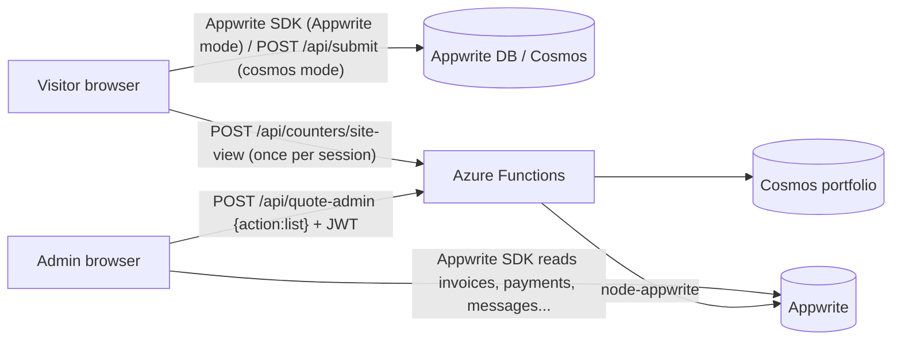
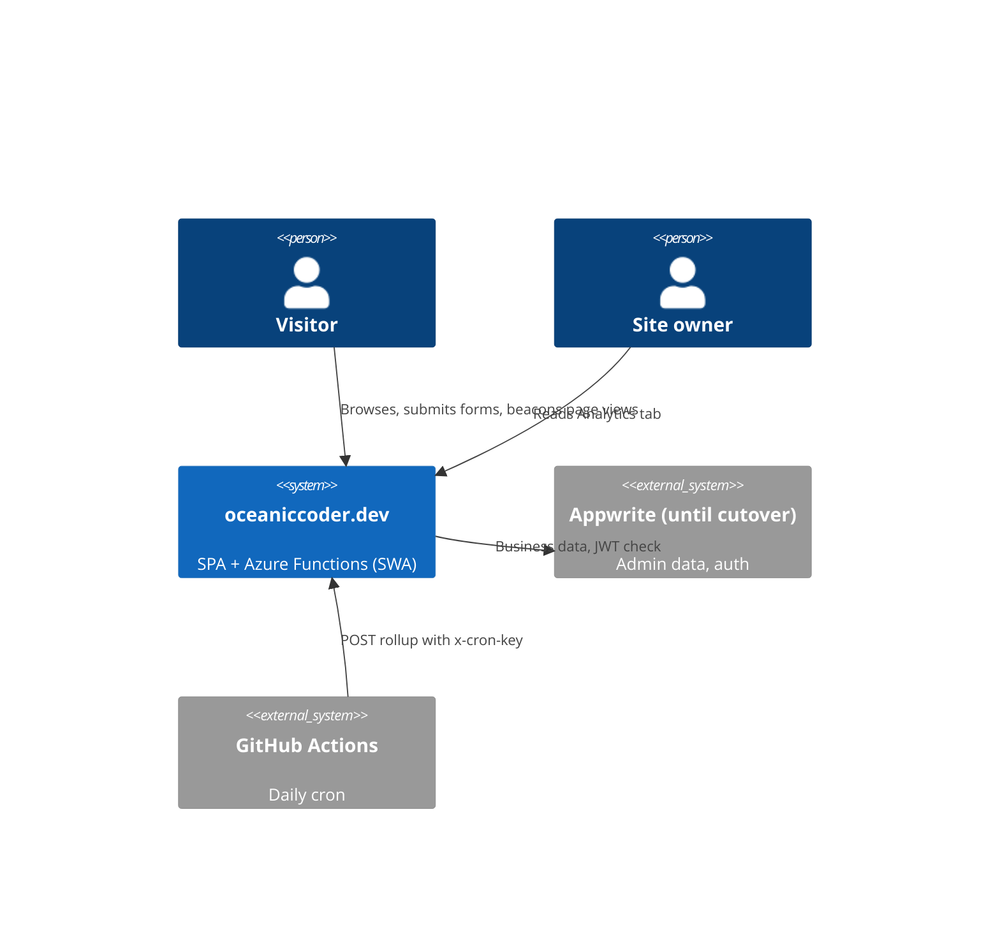
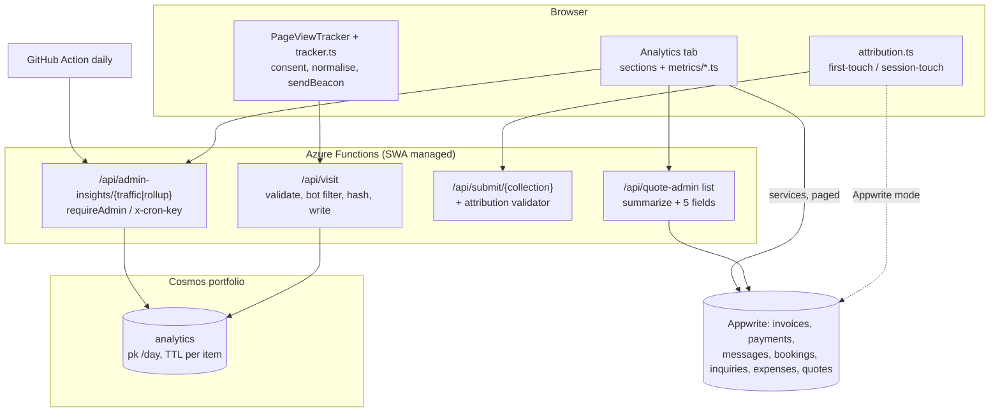
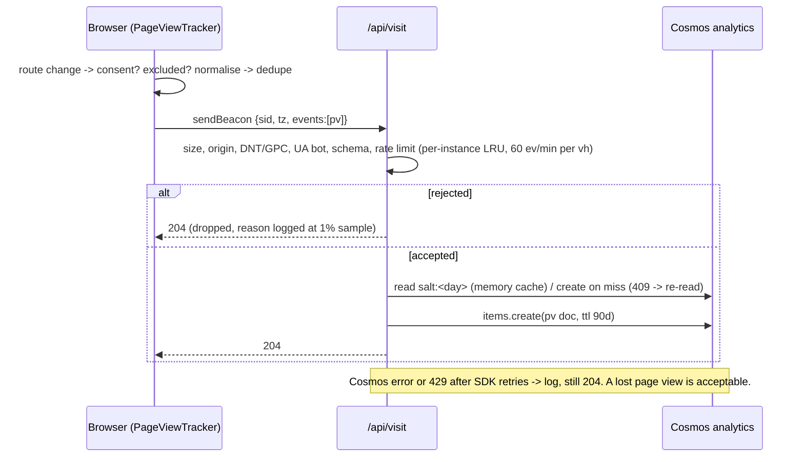
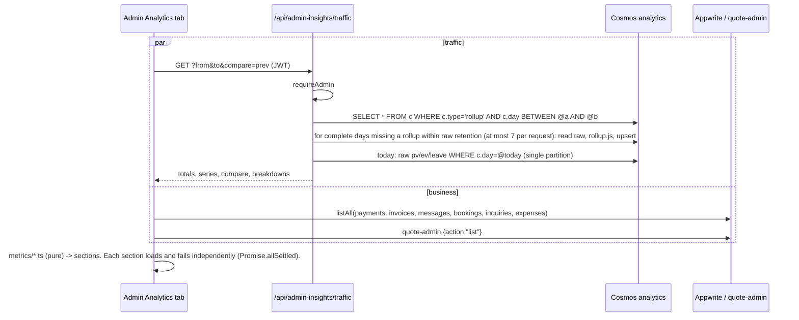
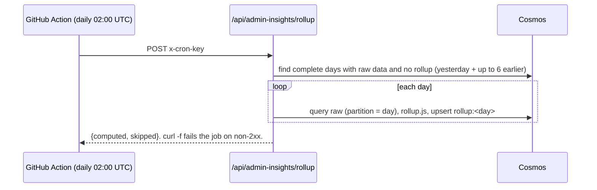
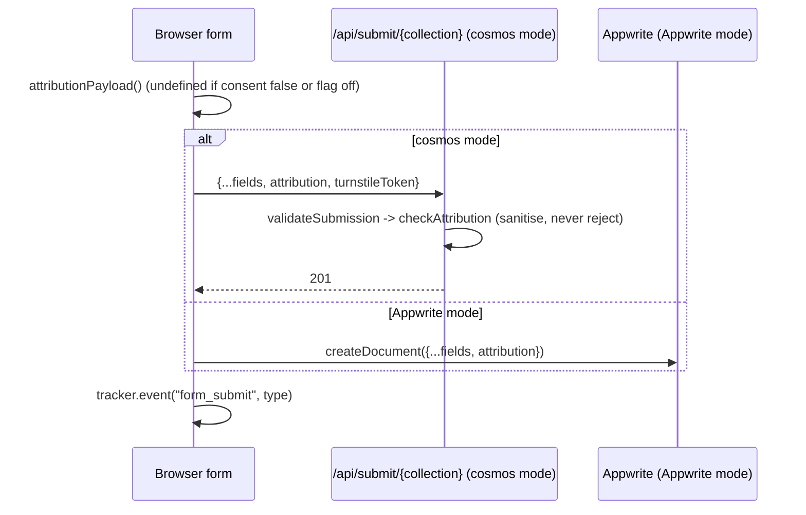

# Design: the admin Analytics dashboard, first-party traffic tracking and lead-source capture

Things I found that you didn't list, and that change the design:

1. **Country data is not available from any request header.** DNS for `oceaniccoder.dev` is at name.com, and the apex points straight at Azure (`dig`: the apex A record and the `www` CNAME both resolve to the Static Web App). There is no Cloudflare in front, so there is no `CF-IPCountry`. Static Web Apps documents no geo header.
2. **The Cosmos database is close to its container limit.** A database with shared throughput holds at most 25 containers. `CONTAINERS` in `api/shared/cosmos.js` has 21. `quotes`, `locks` and `expenses` (`src/lib/appwrite.ts:41`) still have to move, which makes 24. Analytics therefore has room for one container only.
3. **Static Web Apps managed Functions only support HTTP triggers.** Rollups need the cron pattern the repo already uses: a GitHub Action calls an endpoint with `CRON_SECRET` (`.github/workflows/maintenance-offers.yml`, `api/quote-maintenance-due/index.js:7-34`).
4. **`getMessages()` has no limit** (`src/services/api/messages.ts:5-9`), so Appwrite returns its default of 25 rows. This is the same bug as `getPayments`.
5. **Client document URLs carry bearer tokens.** `/q/:token`, `/pay/:invoiceNumber` and `/receipt/:reference` must never be stored as raw paths.
6. **Adding a field in Appwrite mode can break the visitor forms.** Messages, bookings and inquiries are written by the browser straight to Appwrite (`createMessage`, `createBooking`, `inquiries.ts:18-20`). Appwrite rejects attributes it doesn't know, so the new column has to exist in Appwrite before the code that sends it ships.
7. **Cosmos mode has a gap that may affect where leads land.** With `VITE_DATA_BACKEND=cosmos`, visitor writes go to Cosmos (`submitRow`), but the admin reads `getMessages`, `getBookings` and `getInquiries` always query Appwrite. Open question Q1 asks whether the flag is on in production.

---

## 1. Problem

The admin Analytics tab (`src/components/AdminDashboard/tabs/AnalyticsTab.tsx`, 986 lines) only shows revenue, and its numbers are unreliable. The owner wants a professional dashboard with drill-down covering money, the quotes pipeline, site traffic and leads, plus first-party traffic tracking and lead-source attribution. Today the site has no traffic data beyond one all-time counter.

**Users:** the site owner (single admin). Visitors are the people being measured.

**Constraints**

- Existing stack only: React 19, recharts 2.15, Azure Functions (HTTP-only, managed by Static Web Apps), Cosmos free tier (1,000 RU/s shared, 25 containers), and Appwrite until it is deleted at graduation.
- No third-party tracking and no cookies. No raw IP is stored. DNT and GPC are respected.
- PRs of 24 files or fewer. Conventional commits with `OC-0`.
- Admin auth stays `requireAdmin` (Appwrite JWT) until migration Phase 3.

**Non-goals**

- Real-time or live visitor maps.
- Cross-day visitor identity, user-level profiles, or joining a named lead to their browsing path.
- Heatmaps and session replay.
- Moving business data to Cosmos. That is the migration plan's job.
- Backfilling traffic from before deploy.

**Success signal**

- Every KPI on the tab has a written definition and matches a hand count on fixtures.
- Traffic data accrues from the first deploy.
- New leads show a source.

---

## 2. Context: the system as it is

| Area                     | Current state                                                                                                                                                                                                                        | Evidence                                                                                                                                     |
| ------------------------ | ------------------------------------------------------------------------------------------------------------------------------------------------------------------------------------------------------------------------------------ | -------------------------------------------------------------------------------------------------------------------------------------------- |
| Traffic                  | One `site_views` counter, incremented once per browser session. Overview labels it "Total page visits", which is wrong.                                                                                                              | `src/App.tsx:83-95`, `src/services/api/siteViews.ts`, `api/counters/index.js:52-70`, `OverviewTab.tsx:70-76`                                 |
| SPA routing              | `BrowserRouter` and `RouteChangeHandler` (scroll only). No page-view hook. `Logger.trackPageView` is dead code.                                                                                                                      | `src/App.tsx:98-120`, `src/components/RouteChangeHandler.jsx`, `src/utils/logger/Logger.ts:117`                                              |
| Routes                   | Public routes; client document routes with secrets (`/q/:token…`, `/pay/:invoiceNumber`, `/receipt/:reference`); admin routes (`/admin/*`, `/dashboard` read-only)                                                                   | `src/routes/publicRoutes.tsx`, `src/routes/adminRoutes.tsx`                                                                                  |
| Cosmos                   | `getDatabase()` (database `portfolio`, 21 containers, shared 1,000 RU/s). `ensureSchema` creates containers but supports neither TTL nor indexing policy. The counters endpoint always uses Cosmos, whatever the frontend flag says. | `api/shared/cosmos.js:26-48,85-99`                                                                                                           |
| Visitor writes           | `/api/submit/{collection}` uses a strict whitelist (unknown fields are rejected) and Turnstile. In Appwrite mode the browser writes directly.                                                                                        | `api/shared/submissions.js:42-110,147-170`, `api/submit/index.js`, `src/services/api/dataApi.ts:64-75`                                       |
| Bookings                 | `/api/create-booking` handles calendar and email only and stores nothing. The row is saved by `createBooking`.                                                                                                                       | `src/components/BookingSection.jsx:155-205`, `api/create-booking/index.js:512`                                                               |
| Admin auth for Functions | `requireAdmin(context, req)` checks the Appwrite JWT and the admin email. `quote-admin` shows the handler/deps pattern.                                                                                                              | `api/shared/adminAuth.js`, `api/quote-admin/index.js`                                                                                        |
| Revenue                  | Paid invoices bucketed by `$createdAt`, plus quote payments mapped to invoice shape. A hard-coded `TO_GHS` table is applied silently.                                                                                                | `AnalyticsTab.tsx:38-45,86-170,224-252`, `tabs/quoteRevenue.ts`                                                                              |
| Payments ledger          | Invoice-payment rows carry `paidAt`. Quote rows carry `paidAt` and `amountMinor`. `scripts/backfill-payments.mjs` creates rows for legacy paid invoices (paidAt = invoice `$updatedAt`).                                             | `api/paystack-webhook/index.js:410-421`, `InvoicesTab.tsx:177-185`, `api/shared/quotes/settle.js:116-120`, `api/shared/quotes/repo.js:50-56` |
| Row caps                 | `getPayments` no limit (25). `getMessages` no limit (25). `getInvoices` 100. `getInquiries` 100. `getBookings` 200. `getExpenses` 200. `repo.list` 100. `repo.listQuotePayments` 500.                                                | Service files cited above; `repo.js:79-83,131-136`                                                                                           |
| Quote summaries          | `summarize()` omits `createdAt`, `respondedAt`, `validUntil` and `inquiryId`. `expired` is derived (status stays `sent`).                                                                                                            | `api/shared/quotes/views.js:256-291`, `model.js:497`                                                                                         |
| Blog                     | `blog_views` holds one row per (post, visitor) with `reads` and `lastReadAt`. It gives all-time totals only.                                                                                                                         | `api/counters/index.js:72-110`, `tabs/Analytics/BlogReadershipSection.tsx`                                                                   |
| Cron                     | Daily GitHub Action calls the site with `x-cron-key`.                                                                                                                                                                                | `.github/workflows/maintenance-offers.yml`                                                                                                   |
| Overview                 | Fake copy: `"+2 this mo"` and `"Latest: AWS Cloud"`.                                                                                                                                                                                 | `OverviewTab.tsx:50,66`                                                                                                                      |
| Exposure                 | Analytics is hidden on read-only `/dashboard`.                                                                                                                                                                                       | `TabContentExtra.tsx:129`                                                                                                                    |



---

## 3. Options and trade-offs

### 3.1 Where page views are stored

|                                         | A. Appwrite table                                             | **B. One Cosmos container `analytics`**                                                  | C. Azure Table Storage (existing media account) | D. Application Insights                                              | E. Smallest change: daily counters                     |
| --------------------------------------- | ------------------------------------------------------------- | ---------------------------------------------------------------------------------------- | ----------------------------------------------- | -------------------------------------------------------------------- | ------------------------------------------------------ |
| How it works                            | New `page_views` table, written by a Function with an API key | Raw events, daily rollups and salt docs in one container, partition `/day`, per-item TTL | One entity per event, PartitionKey = day        | JS SDK or a Function sends custom events, read with KQL              | `site_views` gets one doc per day, patched with `incr` |
| Survives graduation                     | **No.** The org is deleted.                                   | Yes                                                                                      | Yes                                             | Yes                                                                  | Yes                                                    |
| Aggregation                             | Client or Function paging                                     | SQL `GROUP BY` and in-Function reduce                                                    | None server-side; full scans                    | KQL, strong                                                          | Totals only                                            |
| New dependency                          | None                                                          | None (`@azure/cosmos` 4.4.1 already in use)                                              | `@azure/data-tables`                            | SDK plus an API key for reads                                        | None                                                   |
| Cost at portfolio traffic               | Free-plan limits                                              | Inside the free tier (see 6.4)                                                           | Cents                                           | Free up to 5 GB/month, then per GB; data goes to Microsoft telemetry | Free                                                   |
| Retention                               | Manual deletes                                                | Native TTL per item                                                                      | Manual                                          | Built in, 90 days                                                    | n/a                                                    |
| Reversibility                           | Throwaway                                                     | High (plain JSON docs)                                                                   | Medium                                          | Low (KQL coupling)                                                   | High but useless                                       |
| Fits "own, first-party, no third party" | Yes                                                           | Yes                                                                                      | Yes                                             | Arguable                                                             | Yes, but no dimensions                                 |

**Deciding factor:** Appwrite is going away, and Cosmos is already the target store with a working write pattern (`counters`). A single container is forced by the 25-container cap.

### 3.2 How the admin reads aggregates

|               | **A. Server-side traffic endpoint; business metrics computed in the browser by pure functions** | B. Everything server-side (`/api/admin-insights` also reads invoices, payments, leads from Appwrite) | C. Everything client-side                                                    |
| ------------- | ----------------------------------------------------------------------------------------------- | ---------------------------------------------------------------------------------------------------- | ---------------------------------------------------------------------------- |
| Traffic       | The server reduces rollups plus raw data for today                                              | Same                                                                                                 | Impossible: Cosmos keys can't reach the browser, and raw volume is too large |
| Business data | Existing services, fixed to page through all rows. Volumes are hundreds of rows.                | A second Appwrite reader in Functions, thrown away at the Phase 3 cutover                            | Same as A                                                                    |
| Effort        | Low                                                                                             | High, duplicated by the migration                                                                    | n/a                                                                          |
| Migration fit | Pure metric functions survive. Only the service layer swaps, which the migration already plans. | Rewritten at cutover                                                                                 | n/a                                                                          |

**Deciding factor:** business data is tiny, and its read path is about to be rewritten by the migration. Building a server-side Appwrite reader now is wasted work.

### 3.3 Unique visitors without cookies

|          | sessionStorage `sid` only | localStorage persistent id                | **Daily salted server hash of IP + UA + host, plus `sid` for sessions**            |
| -------- | ------------------------- | ----------------------------------------- | ---------------------------------------------------------------------------------- |
| Sessions | Yes                       | Yes                                       | Yes                                                                                |
| Visitors | No (one per tab)          | Yes, cross-day; it is a cookie equivalent | Per day; cross-day impossible by design                                            |
| Privacy  | Good                      | Weak (persistent identifier)              | Good: IP used in memory only, salt deleted after 48 h, so hashes become unlinkable |

Recommendation: daily salted hash plus `sid`. The owner chose sessionStorage for `sid`. Multi-day "Visitors" is the sum of daily unique visitors, and the UI says so.

### 3.4 Country

|              | **Timezone to country**                                                                | GeoIP database in the Function (DB-IP Lite or GeoLite2 `.mmdb`) | Put Cloudflare in front for `CF-IPCountry`   |
| ------------ | -------------------------------------------------------------------------------------- | --------------------------------------------------------------- | -------------------------------------------- |
| How it works | Client sends `Intl…timeZone`; the server maps it with a static table (about 420 zones) | Look up the IP in memory, then discard it                       | Move DNS to Cloudflare, proxied              |
| Accuracy     | Good for country, wrong for VPNs and travellers                                        | Good                                                            | Good                                         |
| Cost / risk  | About 10 KB of server code, no dependency                                              | New dependency, 5–8 MB, monthly refresh, licence attribution    | DNS change, TLS and proxy interplay with SWA |

Recommendation: timezone now. GeoIP if the owner needs more accuracy (see Risks).

### 3.5 Lead-attribution storage shape

|                       | 8 flat columns (`srcUtmSource`…) | **One `attribution` column, JSON string up to 1,000 chars**        |
| --------------------- | -------------------------------- | ------------------------------------------------------------------ |
| Appwrite console work | 24 attributes across 3 tables    | 3 attributes                                                       |
| Querying              | Possible in Appwrite             | Parsed client-side, which is how aggregation works anyway          |
| Consistency with repo | —                                | Matches the quotes JSON-in-string fields (`repo.js` `JSON_FIELDS`) |

Recommendation: one JSON column.

### 3.6 "Do nothing / smallest change"

Fix the data bugs in PR 1 only, and leave tracking alone. This is cheap and correct, but it leaves traffic and source blind, and the owner explicitly rejected that. PR 1 below is exactly that smallest change, so it ships first regardless.

---

## 4. Decision

- **Storage.** One Cosmos container `analytics`, partition `/day`. Container TTL is on with no default, and each item sets its own `ttl`. Raw events live 90 days, rollups never expire, salt docs live 48 h. The indexing policy is lean.
- **Ingest.** `POST /api/visit` (a neutral name; see Risks), sent with `navigator.sendBeacon`. Bot, origin, DNT/GPC and size filters run server-side, and the response is always 204.
- **Visitor identity.** Visitors come from the daily salted hash. Sessions come from the sessionStorage `sid` with a 30-minute idle rollover.
- **Rollups.** A daily rollup doc is built by a GitHub Action cron through `POST /api/admin-insights/rollup` (`x-cron-key`). If the cron misses a day, the read endpoint computes the missing rollup on demand.
- **Admin read.** `GET /api/admin-insights/traffic` is admin-authed and reduces rollups plus today's raw events.
- **Business metrics.** Computed in the browser by pure, tested functions over services fixed to page through all rows. `summarize()` gains five fields.
- **Money.** Revenue is the payments ledger (`status=success`, dated by `paidAt`), shown per currency. A converted view is optional and labelled "approx.".
- **Attribution.** An `attribution` JSON column on `messages`, `bookings` and `project_inquiries`. First touch is kept in localStorage for 30 days, session touch in sessionStorage. The value is sent with submissions and validated server-side in cosmos mode.

**What would change my mind**

- Traffic above about 50k page views a day: move raw events to Table Storage or ADX and keep rollups in Cosmos.
- A Cloudflare or Front Door move for other reasons: use the edge country header.
- A legal opinion that sessionStorage ids need consent: switch to server-derived sessions (hash plus 30-minute gaps). The rollup change is small and needs no client storage.
- Phase 3 landing first: put business metrics behind `/api/admin-insights` too.

---

## 5. Design

### 5.1 C4 context and containers





### 5.2 Components and responsibilities

**Client**

| Module                               | Responsibility                                                                                                                                                                                                                                                                                                                                                                                                                                                                                                                                                                    |
| ------------------------------------ | --------------------------------------------------------------------------------------------------------------------------------------------------------------------------------------------------------------------------------------------------------------------------------------------------------------------------------------------------------------------------------------------------------------------------------------------------------------------------------------------------------------------------------------------------------------------------------- |
| `src/utils/analytics/consent.ts`     | `trackingAllowed()`. False if `navigator.doNotTrack==="1"`, `navigator.globalPrivacyControl===true`, `navigator.webdriver`, `!import.meta.env.PROD`, `VITE_ANALYTICS_ENABLED!=="true"`, or the localStorage flag `oc_notrack==="1"`. The admin login sets that flag, and `/admin/*` visits set it too, so the owner's own browsing is excluded.                                                                                                                                                                                                                                   |
| `src/utils/analytics/routes.ts`      | `normalisePath(pathname)`: lowercase, strip query and hash and trailing slash, max 150 chars, pattern `^/[a-z0-9/_-]*$`, otherwise returns `null`. `isExcluded(pathname)`: `/admin`, `/dashboard`, `/q/`, `/pay/`, `/receipt/`. Unknown routes, via `matchRoutes` against `publicRoutes` patterns, become `"/(404)"`.                                                                                                                                                                                                                                                             |
| `src/utils/analytics/channel.ts`     | `classify({refHost, utm}) → "direct"\|"search"\|"social"\|"email"\|"paid"\|"referral"`. Rules: utm*medium in {cpc, ppc, paid} → paid; {email, newsletter} → email; social hosts (linkedin.com, lnkd.in, t.co, x.com, twitter.com, facebook.com, instagram.com, youtube.com, reddit.com, wa.me, whatsapp.com) → social; search hosts (google.*, bing.com, duckduckgo.com, yahoo.\_, ecosia.org, baidu.com) → search; any other external host → referral; nothing → direct. The single implementation is used by both the tracker and attribution; the server only checks the enum. |
| `src/utils/analytics/tracker.ts`     | Session (`sid` = `s_` + 16 random bytes base64url in sessionStorage `oc_sid`; `oc_last` timestamp, new sid after 30 min idle). `pageview(path)` and `event(name, prop)`. Sends via `sendBeacon(apiUrl("/api/visit"), Blob(JSON, application/json))`, falling back to `fetch(..., {keepalive:true})`. Never throws. On `pagehide` it sends a `leave` event with the time on the current page.                                                                                                                                                                                      |
| `src/components/PageViewTracker.tsx` | Mounted in `App.tsx` right after `<RouteChangeHandler />`, inside `BrowserRouter`. `useLocation()` and an effect on `pathname`; dedupes with a ref (covers StrictMode and same-path re-renders). The first view of a session carries `ref` (external host only) and UTM from `location.search`. It also calls `captureAttribution()`.                                                                                                                                                                                                                                             |
| `src/utils/analytics/attribution.ts` | `captureAttribution()` on the first view of a session: writes `oc_ft` (localStorage, if absent or older than 30 days) and `oc_st` (sessionStorage). `attributionPayload()` returns the JSON string or `undefined` (also when consent is false).                                                                                                                                                                                                                                                                                                                                   |
| Services                             | `submitRow` in `dataApi.ts` and the Appwrite-mode branches in `messages.ts`, `bookings.ts` and `inquiries.ts` add `attribution` when `VITE_LEAD_ATTRIBUTION==="true"`. Forms call `tracker.event("form_submit", "<contact\|booking\|inquiry\|newsletter\|testimonial\|comment>")` on success.                                                                                                                                                                                                                                                                                     |
| `src/services/api/listAll.ts`        | Pages an Appwrite collection with `Query.limit(100)` plus `Query.cursorAfter(lastId)` until a short page comes back. A hard ceiling of 5,000 rows logs a warning. Used by every analytics read.                                                                                                                                                                                                                                                                                                                                                                                   |
| `src/services/api/insights.ts`       | `getTraffic(params)` using `adminHeaders()` (same JWT transport as `quotes.ts`).                                                                                                                                                                                                                                                                                                                                                                                                                                                                                                  |
| Analytics UI                         | `tabs/Analytics/` (see 5.7). `AnalyticsTab.tsx` becomes a thin shell, lazy-loaded with `React.lazy` inside the dashboard.                                                                                                                                                                                                                                                                                                                                                                                                                                                         |

**Server**

| Module                                        | Responsibility                                                                                                                                                                                                                                                                                                                                                                         |
| --------------------------------------------- | -------------------------------------------------------------------------------------------------------------------------------------------------------------------------------------------------------------------------------------------------------------------------------------------------------------------------------------------------------------------------------------- |
| `api/visit/{function.json,index.js}`          | Route `visit`, POST only. `createHandler(deps)` pattern.                                                                                                                                                                                                                                                                                                                               |
| `api/shared/analytics/validate.js`            | Payload whitelist and limits (5.3).                                                                                                                                                                                                                                                                                                                                                    |
| `api/shared/analytics/ua.js`                  | Regex-only parsing: device (tablet/mobile/desktop), browser family (chrome, safari, firefox, edge, samsung, opera, other), OS (android, ios, windows, macos, linux, other), `isBot` (`/bot\|crawl\|spider\|slurp\|headless\|lighthouse\|pagespeed\|preview\|facebookexternalhit\|embedly\|curl\|wget\|python\|axios\|node-fetch\|go-http/i`, or a missing UA). The UA is never stored. |
| `api/shared/analytics/tzCountry.js`           | IANA zone to ISO-3166 alpha-2, else `null`.                                                                                                                                                                                                                                                                                                                                            |
| `api/shared/analytics/visitor.js`             | `getSalt(db, day)`: reads `salt:<day>`, otherwise creates 32 random bytes with ttl 172800; a 409 race leads to a re-read; cached in memory per day. `visitorHash = HMAC-SHA256(salt, ip + "\n" + ua + "\n" + host).hex.slice(0,16)`. The IP comes from `clientIp(req)` in `turnstile.js` and only lives in memory.                                                                     |
| `api/shared/analytics/rollup.js`              | Pure: raw docs → rollup doc (5.3).                                                                                                                                                                                                                                                                                                                                                     |
| `api/shared/analytics/query.js`               | Range parsing, bucketing, merging rollup docs, compare period. Pure.                                                                                                                                                                                                                                                                                                                   |
| `api/admin-insights/{function.json,index.js}` | Route `admin-insights/{action}`: `GET traffic` (requireAdmin), `POST rollup` (`x-cron-key`, reusing `sameSecret` from `quote-maintenance-due`, moved to `api/shared/cron.js`).                                                                                                                                                                                                         |
| `api/shared/submissions.js`                   | Adds `attribution: { type: "attribution" }` to `messages`, `bookings` and `project_inquiries`, with a `checkAttribution` case in `checkField`.                                                                                                                                                                                                                                         |
| `api/shared/quotes/views.js` `summarize`      | Adds `createdAt`, `respondedAt`, `validUntil`, `inquiryId`, `declineReason`.                                                                                                                                                                                                                                                                                                           |
| `api/shared/quotes/repo.js`                   | `list()` and `listQuotePayments()` page with `cursorAfter` instead of the 100 and 500 caps.                                                                                                                                                                                                                                                                                            |
| `api/shared/cosmos.js`                        | `CONTAINERS.analytics = { partitionKey: "/day", defaultTtl: -1, indexingPolicy }`. `ensureSchema` passes `defaultTtl` and `indexingPolicy` through.                                                                                                                                                                                                                                    |

### 5.3 Data model and contracts

**Ingest request: `POST /api/visit`** (Content-Type `application/json`, body of 4 KB or less, at most 10 events)

```jsonc
{
  "v": 1,
  "sid": "s_3q8Zr0kD2m1xVb7YtQ9wLw", // /^s_[A-Za-z0-9_-]{16,32}$/
  "tz": "Africa/Accra", // optional, at most 64 chars
  "lang": "en-GB", // optional, /^[a-z]{2,3}(-[A-Za-z]{2,4})?$/
  "events": [
    {
      "t": "pv",
      "path": "/blog/my-post", // normalised; server re-checks the pattern and exclusions
      "entry": true, // first pv of this sid
      "ref": "www.linkedin.com", // external host only, at most 100, entry only
      "utm": {
        "source": "linkedin",
        "medium": "social",
        "campaign": "oct-launch",
        "term": null,
        "content": null,
      }, // each at most 100, entry only
      "ch": "social", // enum
      "prevMs": 42000,
    }, // optional, 0..1,800,000: time on the previous page
    { "t": "ev", "name": "form_submit", "prop": "booking", "path": "/booking" },
    { "t": "leave", "path": "/booking", "ms": 30500 },
  ],
}
```

- **Response:** always `204`, except `413` for oversize bodies and `405` for methods other than POST.
- **Dropped silently:** bad JSON, failed validation, `DNT: 1` or `Sec-GPC: 1` request headers, a bot UA, an `Origin`/`Referer` host not in `ANALYTICS_ALLOWED_HOSTS` (default `oceaniccoder.dev,www.oceaniccoder.dev`, which drops SWA preview environments and localhost), `Sec-Fetch-Site` present and not `same-origin`, an excluded path, a rate limit hit, or `ev.name` not in the allowlist.
- **Event allowlist:** `form_submit` with prop in {contact, booking, inquiry, newsletter, testimonial, comment}; `cta_click` with prop up to 40 chars matching `[a-z0-9_-]`; `outbound` with prop as a host; `resume_download`; `chat_open`.

**Raw docs in `analytics`**

```jsonc
// page view
{ "id": "<newId>", "type": "pv", "day": "2026-10-20", "ts": "2026-10-20T09:14:03.120Z",
  "sid": "s_…", "vh": "a1b2c3d4e5f60718", "path": "/blog/my-post", "entry": true,
  "ref": "www.linkedin.com", "ch": "social",
  "utm": { "s": "linkedin", "m": "social", "c": "oct-launch", "t": null, "x": null },
  "dev": "mobile", "br": "chrome", "os": "android", "cc": "GH", "lang": "en",
  "prevMs": 42000, "ttl": 7776000 }
// interaction event
{ "id": "…", "type": "ev", "day": "…", "ts": "…", "sid": "…", "vh": "…",
  "name": "form_submit", "prop": "booking", "path": "/booking", "ttl": 7776000 }
// leave
{ "id": "…", "type": "leave", "day": "…", "ts": "…", "sid": "…", "path": "/booking", "ms": 30500, "ttl": 7776000 }
// salt (never returned by any endpoint)
{ "id": "salt:2026-10-20", "type": "salt", "day": "2026-10-20", "salt": "<base64 32B>", "ttl": 172800 }
```

`day` is the UTC date. Ghana is UTC+0 with no daylight saving, so UTC days are local days. `ts` is server time; client clocks are ignored.

**Daily rollup doc** (`ttl` omitted, so it never expires)

```jsonc
{ "id": "rollup:2026-10-20", "type": "rollup", "day": "2026-10-20", "v": 1,
  "computedAt": "2026-10-21T02:05:11Z",
  "totals": { "pageviews": 412, "sessions": 160, "visitors": 131, "bounces": 74,
              "engagedMs": 9123000, "sessionsWithDuration": 120,
              "excludedSessions": 2 },                       // sessions with >200 pv in a day: treated as bots
  "pages":     [["/", 120, 98], ["/blog/my-post", 40, 33]], // [path, pageviews, sessions], top 100, then ["(other)", …]
  "entry":     [["/", 80], …],                               // [path, sessions], top 50
  "referrers": [["www.linkedin.com", 22], …],               // [host, sessions], top 50
  "channels":  { "direct": 70, "search": 30, "social": 40, "referral": 15, "email": 3, "paid": 2 },
  "utmSource": [["linkedin", 20]], "utmCampaign": [["oct-launch", 12]],
  "devices": { "mobile": 90, "desktop": 65, "tablet": 5 },
  "browsers": { "chrome": 100, … }, "os": { "android": 70, … },
  "countries": [["GH", 120], ["US", 15], ["(unknown)", 5]],
  "events": { "form_submit:booking": 3, "form_submit:contact": 2, "cta_click:hire-me": 9 } }
```

Breakdowns count sessions, keyed on each session's entry page view, except `pages`, which counts page views and distinct sessions.

**Definitions used by the rollup**

- **Session:** distinct `sid` within the day.
- **Visitor:** distinct `vh` within the day.
- **Bounce:** a session with exactly one page view and no `ev` of type `cta_click`, `outbound`, `form_submit` or `resume_download`.
- **Engaged time per session:** the sum of `prevMs` plus the last `leave.ms`, each capped at 30 minutes. Average duration = `engagedMs / sessionsWithDuration`.

**Indexing policy for `analytics`:** `includedPaths` are `/type/?`, `/day/?`, `/ts/?` and `/sid/?`; `excludedPaths` is `/*`. Writes cost about 5–6 RU per 1 KB document.

**Admin read: `GET /api/admin-insights/traffic`** (header `x-appwrite-jwt`)

Query parameters:

- `from=YYYY-MM-DD&to=YYYY-MM-DD` (inclusive, at most 400 days, `to` no later than today)
- `bucket=day|week|month` (default: 31 days or less → day, 180 or less → week, otherwise month)
- `compare=prev|none` (default `prev`: the same length immediately before)
- `filter=<dim>:<value>`, optional. `dim` is one of `path`, `ref`, `ch`, `utmSource`, `utmCampaign`, `dev`, `cc`. Filters are only served from raw events, so `from` must fall within the raw retention window; otherwise the response is 400 `"Filters cover the last 90 days only"`.

```jsonc
{
  "range": { "from": "2026-09-21", "to": "2026-10-20", "bucket": "day" },
  "firstDataDay": "2026-10-14", // earliest rollup or raw doc; the UI hides deltas before it
  "lastRollupAt": "2026-10-20T02:05:11Z",
  "partialToday": true,
  "totals": {
    "pageviews": 4012,
    "visitors": 1290,
    "sessions": 1540,
    "bounceRate": 0.46,
    "avgDurationMs": 76000,
    "pagesPerSession": 2.6,
  },
  "compareTotals": {
    "pageviews": 0,
    "visitors": 0,
    "sessions": 0,
    "bounceRate": null,
    "avgDurationMs": null,
    "pagesPerSession": null,
  },
  "series": [{ "date": "2026-09-21", "pageviews": 0, "visitors": 0, "sessions": 0 }],
  "compareSeries": [{ "date": "2026-08-22", "pageviews": 0, "visitors": 0, "sessions": 0 }],
  "breakdowns": {
    "pages": [{ "key": "/", "pageviews": 900, "sessions": 700 }],
    "entry": [],
    "referrers": [],
    "channels": [],
    "utmSource": [],
    "utmCampaign": [],
    "devices": [],
    "browsers": [],
    "os": [],
    "countries": [],
  },
  "events": [{ "key": "form_submit:booking", "count": 6 }],
}
```

- **Errors:** 400 `{error}` for a bad range or filter; 401/403 from `requireAdmin`; 503 `{error:"Traffic data is unavailable right now."}` when Cosmos fails.
- Multi-day `visitors` is the sum of daily uniques, and the UI labels it "Visitors (daily uniques summed)".

**Rollup: `POST /api/admin-insights/rollup`** (header `x-cron-key`). Body `{ "days"?: ["2026-10-19"] }`; the default is yesterday plus up to 6 earlier complete days that have raw data but no rollup. Upserts by `id`, so re-runs are safe. Returns `{ computed: [...], skipped: [...] }`.

**Lead `attribution` column** (string, at most 1,000 chars, JSON):

```jsonc
{
  "v": 1,
  "ft": {
    "at": "2026-10-14T10:00:00Z",
    "landing": "/projects/craigtec",
    "ref": "www.linkedin.com",
    "ch": "social",
    "utm": { "s": "linkedin", "m": "social", "c": "oct-launch" },
  }, // first touch, kept 30 days
  "st": { "landing": "/services", "ref": null, "ch": "direct", "utm": {} },
} // this session's touch
```

- `checkAttribution` (cosmos mode) parses the JSON, keeps only these keys, truncates strings (landing 150, ref 100, utm values 100), re-checks `landing` with the path pattern, `ref` with a hostname pattern and `ch` against the enum, then re-serialises. Malformed JSON is dropped rather than rejected, so a bad value never costs a lead.
- No `sid` and no visitor hash: a named lead is never linked to a browsing trail. Conversion is measured in aggregate through `form_submit` events.
- In Appwrite mode the browser writes directly with no server validation, which is the same accepted risk as every other field there. The admin UI renders the value as escaped text.

**`summarize()` additions (five fields):** `createdAt`, `respondedAt`, `validUntil`, `inquiryId` (for the inquiry → quote rate) and `declineReason` (the owner approved showing decline reasons in the Quotes section, Q8). It stays a whitelist, and its only caller is the admin-only quote-admin `list` action.

### 5.4 Main flows









**Failure paths**

- **Tracker:** `sendBeacon` returns false, so it tries `fetch` with keepalive and swallows errors. Ad-blocked requests are lost, which is accepted.
- **Ingest:** salt read fails → drop the event, never use an unsalted hash. Cosmos 429 → SDK retry, then drop.
- **Admin read:** traffic 503 → a section-level error card with Retry while the other sections render. A missing rollup is computed on demand. Beyond raw retention a missing day is reported as `gaps:[days]` and drawn as a gap, not as zero.
- **Rollup:** idempotent upsert. A partial failure leaves days for the next run or for the on-demand path.
- **Attribution:** bad data is dropped server-side. If the Appwrite column is missing, the feature flag must stay off; see the rollout order.

### 5.5 State, caching, auth and permissions

- `/api/visit` is anonymous by necessity. It never returns data, so it is write-only.
- `/api/admin-insights/traffic` uses `requireAdmin` (fail-closed). At Phase 3 it moves to the SWA `admin` role plus a Function check, the same as the other admin Functions.
- `/api/admin-insights/rollup` uses only `x-cron-key` with a timing-safe compare.
- Responses use `Cache-Control: no-store` (existing `http.js` `send`). The client keeps the last response in memory per range, so switching sections doesn't refetch; the Refresh button does.
- The Analytics tab stays hidden on read-only `/dashboard` (`TabContentExtra.tsx:129` is unchanged).

### 5.6 KPI definitions (every number on the tab)

**Range model.** Presets 7d, 30d, 90d, 12m and Custom (date-range inputs, at most 400 days). `to` = today (UTC). The previous period is the same length, ending the day before `from`.

- `Δ% = (cur − prev) / prev`. If `prev = 0` and `cur > 0`, show "New". If both are 0, show "–".
- Traffic deltas are hidden when `prev` overlaps days before `firstDataDay`; the card shows "Collecting since <date>".
- The range is held in component state and persisted to `localStorage.oc_analytics_range`.

**Currency.** Native per currency by default: a currency switch chip (GHS | USD | …), defaulting to the currency with the most revenue in range, and each money card lists the other currencies underneath. An optional "Converted (approx.)" toggle uses `src/config/fxRates.ts` (`{ asOf, toGHS }`) and always labels the result "≈ ₵…, at rates as of <asOf>". No mixed-currency sum is ever shown unlabelled.

**Revenue ledger (`metrics/revenue.ts`)**

- Rows are `payments` with `status === "success"`, both `kind` invoice and quote.
- `amountMajor = Number.isInteger(amountMinor) ? amountMinor / 100 : amount`.
- `date = paidAt ?? $createdAt`.
- Gap fill: a paid invoice with no payment row (matched by `invoiceNumber`) is added with `date = $updatedAt` and flagged `estimated`. A reconciliation note reads "N paid invoices have no payment record, so their date is estimated. Run `scripts/backfill-payments.mjs`."
- `failed`, `duplicate`, `abandoned`, `pending` and `refunded` are excluded.

| Section                | KPI                                                                           | Definition                                                                                                                                                | Source                                      | Chart / drill-down                                                                                     |
| ---------------------- | ----------------------------------------------------------------------------- | --------------------------------------------------------------------------------------------------------------------------------------------------------- | ------------------------------------------- | ------------------------------------------------------------------------------------------------------ |
| **Summary strip**      | Cash collected                                                                | Σ ledger amounts dated in range, per currency                                                                                                             | payments (+ gap fill)                       | Sparkline. Click opens Revenue.                                                                        |
|                        | Outstanding                                                                   | Σ unpaid invoices (`status==="sent"`) + Σ quote stage invoices with `state==="due"`, as of now                                                            | invoices, quote summaries `.invoices[]`     | Click opens Outstanding list                                                                           |
|                        | New leads                                                                     | Count of messages + inquiries + bookings with `$createdAt` in range                                                                                       | Appwrite (paged)                            | Click opens Leads                                                                                      |
|                        | Quote win rate                                                                | accepted ÷ (accepted + declined + expired), counting quotes whose `respondedAt` (or `validUntil` for expired) is in range                                 | quote summaries                             | Click opens Quotes                                                                                     |
|                        | Visitors                                                                      | Σ daily unique visitors in range                                                                                                                          | admin-insights                              | Sparkline                                                                                              |
|                        | Lead conversion rate                                                          | `form_submit` events (contact + booking + inquiry) ÷ sessions, in range                                                                                   | admin-insights                              | Tooltip states the definition                                                                          |
| **Revenue & payments** | Cash collected over time                                                      | Ledger bucketed by the range bucket, stacked by `kind` (invoice / quote); the previous period is a dashed line                                            | ledger                                      | `ComposedChart` (Bar + Line). A bar opens the payment list for that bucket.                            |
|                        | Payments count; average payment                                               | Count of ledger rows; mean amount per currency                                                                                                            | ledger                                      | KPI cards. "Avg payment" replaces the mislabelled "Avg project".                                       |
|                        | By method                                                                     | Σ by `method` (card, momo, bank, apple_pay, cash)                                                                                                         | ledger                                      | Donut `PieChart`                                                                                       |
|                        | Top clients                                                                   | Σ by `clientEmail` (fallback `clientName`), top 10                                                                                                        | ledger                                      | Table → client's payments                                                                              |
|                        | Outstanding and overdue                                                       | Overdue = invoice `dueDate` < today or stage `overdue===true`. Ageing buckets 0–30, 31–60, 61+ days.                                                      | invoices, quote summaries                   | Horizontal `BarChart`, table                                                                           |
|                        | Expenses                                                                      | Σ `expenses.amount` with `date` in range, per currency, by category                                                                                       | expenses (paged)                            | Stacked `BarChart` by bucket; list with add/delete (existing form kept)                                |
|                        | Net                                                                           | Cash collected − expenses in range, per currency (never cross-currency unless converted)                                                                  | both                                        | KPI card                                                                                               |
| **Quotes pipeline**    | Created / Sent                                                                | Count with `createdAt` / `sentAt` in range                                                                                                                | quote summaries                             | KPI cards                                                                                              |
|                        | Funnel                                                                        | Of quotes **sent in range**: Sent → Viewed (`viewedAt`) → Accepted → Deposit paid (`paidMinor > 0`) → Fully paid (`complete`). Conversion % at each step. | quote summaries                             | Horizontal `BarChart` styled as a funnel; a step opens the quotes in it                                |
|                        | Win rate                                                                      | As in the summary strip                                                                                                                                   |                                             |                                                                                                        |
|                        | Median time to view                                                           | median(`viewedAt − sentAt`) for quotes sent in range that were viewed                                                                                     |                                             | KPI                                                                                                    |
|                        | Median time to decision                                                       | median(`respondedAt − sentAt`) for accepted or declined quotes                                                                                            |                                             | KPI                                                                                                    |
|                        | Open pipeline value                                                           | Σ `totalMinor` where status is `sent` and `validUntil` ≥ now, per currency                                                                                |                                             | KPI; "Expiring in 7 days" list                                                                         |
|                        | Won value / collected / balance                                               | Σ `totalMinor` of accepted with `respondedAt` in range; Σ `paidMinor`; difference                                                                         |                                             | Stacked bar per currency                                                                               |
|                        | Inquiry → quote rate                                                          | Inquiries created in range that have ≥1 quote with a matching `inquiryId`, ÷ inquiries created in range                                                   | inquiries + summaries                       | KPI                                                                                                    |
|                        | Status mix                                                                    | Count by effective status (`sent` with `validUntil < now` counts as `expired`)                                                                            |                                             | Donut                                                                                                  |
| **Leads & bookings**   | Leads over time                                                               | Counts by type per bucket, previous period dashed                                                                                                         | messages, inquiries, bookings               | Stacked `BarChart` → lead list for the bucket                                                          |
|                        | Leads by source                                                               | Channel from `attribution.ft.ch` (fallback `st.ch`), else "unknown (before tracking)"                                                                     | attribution column                          | Donut plus a table of referrer and campaign                                                            |
|                        | Inquiry outcomes                                                              | Count by `status` (new, reviewed, quoted, declined, won); win rate = won ÷ (won + declined)                                                               | inquiries                                   | Bar                                                                                                    |
|                        | Project type and budget mix                                                   | Count by `projectType` and `budgetRange`                                                                                                                  | inquiries                                   | Horizontal bars                                                                                        |
|                        | Bookings                                                                      | Count created in range; by `meetingType`; by `status`; upcoming next 7 days (`preferredDate`)                                                             | bookings                                    | Bars and an upcoming list                                                                              |
|                        | Unhandled messages                                                            | `status==="new"` count, now                                                                                                                               | messages                                    | KPI → Messages tab                                                                                     |
| **Site traffic**       | Visitors, Sessions, Pageviews, Pages/session, Bounce rate, Avg visit duration | As defined in 5.3                                                                                                                                         | admin-insights                              | KPI cards with Δ; `AreaChart` visitors and pageviews plus a dashed previous period                     |
|                        | Top pages, Entry pages                                                        | From breakdowns                                                                                                                                           |                                             | Table with inline bars. A row sets `filter=path:…` and the whole section re-queries (90 days or less). |
|                        | Channels, Referrers, UTM source and campaign                                  |                                                                                                                                                           |                                             | Donut and tables → filter                                                                              |
|                        | Devices, Browsers, OS, Countries                                              | Countries are derived from timezone and labelled as such                                                                                                  |                                             | Donuts and a country table                                                                             |
|                        | Events                                                                        | `cta_click`, `outbound`, `resume_download`, `chat_open` counts                                                                                            |                                             | Table                                                                                                  |
| **Content**            | Blog readers per post (all time)                                              | Existing `BlogReadershipSection`                                                                                                                          | blog_views                                  | kept                                                                                                   |
|                        | Blog page views in range                                                      | `pages` breakdown filtered to `/blog/*`                                                                                                                   | admin-insights                              | Bar, top 10 → page filter                                                                              |
|                        | Reactions                                                                     | likes and dislikes per post                                                                                                                               | blog_reactions (existing counters endpoint) | Table                                                                                                  |

**Overview tab fixes**

- "Total Projects" change becomes the count with `$createdAt` in the last 30 days.
- "Certifications" change becomes `Latest: <title>` of the newest certification by `$createdAt`, or "None yet".
- "Site Views" becomes "Sessions (all time)" until analytics has 30 days of data, then switches to "Visitors (30 days)" from `/api/admin-insights/traffic`, with the legacy counter shown underneath.

**Known bugs, all fixed by the above**

1. Revenue was bucketed by invoice `$createdAt`; it now uses the ledger's `paidAt`.
2. Silent `TO_GHS` sums are gone.
3. `primaryCurrencyEntry` sorted using the first key's rate for both sides (`AnalyticsTab.tsx:256-261`).
4. "Avg project" is really an average per invoice.
5. All-time expenses were netted against period revenue.
6. The weekly view showed the current week only, and the monthly view the current year only.
7. Pending ignored due quote stages.
8. Truncation at 25, 100, 200 and 500 rows.
9. Fake Overview copy.
10. The Site Views label.

### 5.7 UI structure (`src/components/AdminDashboard/tabs/Analytics/`)

- `AnalyticsShell.tsx`: sticky header with the range picker, compare toggle, currency chip, converted toggle and Refresh. A section nav: Summary · Revenue · Quotes · Leads · Traffic · Content.
- `RangePicker.tsx`, `KpiCard.tsx` (value, Δ, sparkline, tooltip definition), `ChartCard.tsx` (title, empty, error, loading states), `BreakdownTable.tsx`, `FilterChip.tsx`.
- `sections/{Summary,Revenue,Quotes,Leads,Traffic,Content}Section.tsx`.
- `metrics/{range,revenue,quotes,leads,format}.ts`: pure and fully unit-tested.
- `useAnalyticsData.ts`: loads business data once (paged) and caches traffic per range.
- Empty states: "Collecting since <deploy date>"; "No payments in this range".

### 5.8 Observability

- `/api/visit` logs drop reasons at a 1% sample and Cosmos errors in full.
- The rollup returns `{computed, skipped}`; the Action fails loudly.
- The traffic response includes `lastRollupAt`, and the UI shows "Rollup N days old" if it is more than 2 days old.
- `x-ms-request-charge` is logged per admin query, to watch RU.
- A weekly manual check during the first month: Cosmos Data Explorer, `SELECT COUNT(1) FROM c WHERE c.type='pv'`, and spot-check that no doc holds an IP or UA.

### 5.9 Test strategy

- **Unit, api (vitest):**
  - `validate.js`: limits, unknown keys, events above 10, enums.
  - `ua.js`: fixture UAs including bots and headless.
  - `tzCountry.js`.
  - `visitor.js`: same input on the same day gives the same hash; a different day gives a different hash; a 409 salt race; never hashes without a salt.
  - `rollup.js` fixtures: bounce, duration caps, >200 page-view sessions excluded, top-N plus "(other)", entry attribution.
  - `query.js`: buckets, compare windows, gap days, today partial.
  - `checkAttribution`: strips unknown keys, rejects bad hosts and paths, drops malformed JSON, never throws.
- **Handler tests** (deps injection, like `quote-admin.test.js`):
  - `visit`: DNT or GPC header → no write; foreign origin → no write; oversize → 413; bot → no write; happy path writes one doc with no IP or UA fields.
  - `admin-insights`: 401, 403, range above 400 days, filter beyond retention, cron key wrong or missing.
- **Unit, src:**
  - `routes.ts`: exclusions; `/q/abc` is never emitted; 404.
  - `channel.ts`.
  - `consent.ts`.
  - `attribution.ts`: 30-day expiry, consent off gives undefined.
  - `tracker.ts`: sendBeacon mocked, fetch fallback, sid rollover after 30 minutes.
  - `listAll.ts`: stops on a short page, ceiling.
  - `metrics/*` with hand-computed fixtures (legacy invoice gap fill, refunded excluded, per currency, expired derivation, medians, prev = 0 deltas).
  - Existing `quoteRevenue.test.ts` is replaced by the ledger tests.
- **Component:** `RangePicker`, `KpiCard` Δ rendering, sections render empty and error states, Overview copy uses real data.
- **Manual (required by CLAUDE.md for new UI):**
  - Browser check of every section, light and dark.
  - Visit the production site with DNT on, Brave, uBlock Origin and EasyPrivacy, and an admin-flagged browser; confirm the expected docs appear or don't.
  - A test submission of each form carries attribution.
  - Gates: `type-check`, `lint`, `format:check`, `build`.

### 5.10 Security and privacy notes

- **No raw IP or UA at rest.** The salt is deleted after 48 h (TTL), and no endpoint returns salts or raw events.
- **Secrets in URLs.** Client document routes are excluded client-side and again server-side. Path validation rejects anything outside `[a-z0-9/_-]`.
- **Abuse.** `/api/visit` can be spammed to inflate numbers. The mitigations are the origin and fetch-metadata checks, the bot UA filter, per-instance rate limits, the per-session cap applied in the rollup, and the 4 KB body cap. Turnstile is not used because it is heavy for a beacon. The worst case is inflated stats, not data exposure.
- **Lead attribution** is personal data once attached to a named lead (Ghana Data Protection Act, 2012, Act 843). See R4.

---

## 6. Rollout

### 6.1 PR plan (in order; each 24 files or fewer)

| #   | Title                                                           | Contents (approx. files)                                                                                                                                                                                                                                                                                                                                                                          | Depends                                                     |
| --- | --------------------------------------------------------------- | ------------------------------------------------------------------------------------------------------------------------------------------------------------------------------------------------------------------------------------------------------------------------------------------------------------------------------------------------------------------------------------------------- | ----------------------------------------------------------- |
| 1   | `fix(OC-0): page through all rows and correct analytics inputs` | `listAll.ts` plus tests; payments, invoices, messages, inquiries, bookings and expenses use it in admin reads; quotes `repo.list` / `listQuotePayments` paging plus tests; `summarize` +5 fields plus test; Overview fake copy and label. **Coordinate with the in-flight `getPayments` fix: rebase onto it or fold it in.** (~16)                                                                | —                                                           |
| 2   | `feat(OC-0): first-party page-view tracking`                    | `api/visit/*`, `api/shared/analytics/{validate,ua,tzCountry,visitor}.js` plus tests, `cosmos.js` (analytics container, TTL, indexing), `src/utils/analytics/{consent,routes,channel,tracker}.ts` plus tests, `PageViewTracker.tsx`, `App.tsx`, the workflow env line `VITE_ANALYTICS_ENABLED`, a CLAUDE.md env table row. Admin login sets `oc_notrack`. (~22) Ship early: data starts at deploy. | console steps A1–A3                                         |
| 3   | `feat(OC-0): lead source on messages, bookings and inquiries`   | `attribution.ts` plus test, `dataApi.submitRow`, 3 services, `submissions.js` plus tests, `form_submit` events in the 6 forms, a source line in the Messages, Bookings and Inquiry detail views. Behind `VITE_LEAD_ATTRIBUTION`. (~18)                                                                                                                                                            | **Appwrite columns B1 must exist before the flag is set**   |
| 4   | `feat(OC-0): traffic rollups and admin insights endpoint`       | `api/admin-insights/*`, `api/shared/analytics/{rollup,query}.js` plus tests, `api/shared/cron.js` (extract `sameSecret`; `quote-maintenance-due` imports it), `.github/workflows/analytics-rollup.yml`, `src/services/api/insights.ts`. (~13)                                                                                                                                                     | 2                                                           |
| 5   | `feat(OC-0): analytics dashboard shell, revenue and expenses`   | Shell, RangePicker, KpiCard, ChartCard, BreakdownTable, `metrics/{range,revenue,format}.ts` plus tests, Summary (money tiles) and Revenue sections, `fxRates.ts`, remove `quoteRevenue.ts` and its test, `AnalyticsTab.tsx` becomes a thin lazy shell. (~22)                                                                                                                                      | 1                                                           |
| 6   | `feat(OC-0): quotes pipeline and leads analytics`               | `metrics/{quotes,leads}.ts` plus tests, the Quotes and Leads sections, plus tests. (~10)                                                                                                                                                                                                                                                                                                          | 1, 3 (the source donut degrades to "unknown" without it), 5 |
| 7   | `feat(OC-0): traffic and content analytics with drill-down`     | Traffic and Content sections, FilterChip, `useAnalyticsData` traffic cache, the Overview "Visitors (30 days)" switch, tests. (~12)                                                                                                                                                                                                                                                                | 4, 5                                                        |
| 8   | `chore(OC-0): retire the legacy site-view counter`              | After 30 or more days of data: remove the `incrementSiteViews` effect, the dead `Logger.trackPageView`, and the Overview legacy line. Keep `/api/counters/site-views` read-only, or drop it. (~5)                                                                                                                                                                                                 | 7 plus 30 days                                              |

PRs 2 and 3 go out as early as possible, right after PR 1 (or in parallel with it), because traffic and source data only accrue from deploy. Per the memory note, parallel agents should use worktrees and must not commit mid-run.

### 6.2 Console and configuration steps (exact)

**Azure Cosmos** (the Cosmos account and the site's database). Do A1 before PR 2 merges.

- A1. Create container `analytics`:
  - Partition key `/day`.
  - **Use the database's shared throughput. Do not provision container throughput**, or it is billed separately.
  - Time to Live: **On (no default)**, which is `defaultTtl: -1`.
  - Indexing policy: `{"indexingMode":"consistent","includedPaths":[{"path":"/type/?"},{"path":"/day/?"},{"path":"/ts/?"},{"path":"/sid/?"}],"excludedPaths":[{"path":"/*"}]}`.
  - Alternatively run the updated `ensureSchema` through `scripts/import-to-cosmos.mjs`'s schema step, if it exposes one (verify).
  - This brings the database to 22 containers; 24 after quotes, locks and expenses move; the limit is 25.

**Azure Static Web App → Configuration → Application settings**

- A2. `ANALYTICS_ALLOWED_HOSTS=oceaniccoder.dev,www.oceaniccoder.dev`. Optional, since the code defaults to this.
- A3. Confirm `COSMOS_ENDPOINT`, `COSMOS_KEY`, `CRON_SECRET` and `ADMIN_EMAIL` or `VITE_ADMIN_EMAIL` are already set. No new secrets: salts live in Cosmos.
- Optional: `ANALYTICS_RAW_TTL_DAYS=90`.

**GitHub → Settings → Secrets and variables → Actions**

- G1. Variables `VITE_ANALYTICS_ENABLED=true` (after PR 2 deploys and A1 exists) and `VITE_LEAD_ATTRIBUTION=true` (only after B1). Both also need lines in the `env:` block of `.github/workflows/azure-static-web-apps.yml`, next to `VITE_DATA_BACKEND` (line 53). That edit is in PRs 2 and 3.
- G2. Secret `CRON_SECRET`: reuse the existing one for `analytics-rollup.yml` (cron `5 2 * * *` plus `workflow_dispatch`).

**Appwrite** (while it remains the store). Do B1 before setting `VITE_LEAD_ATTRIBUTION`.

- B1. In the portfolio database (`VITE_APPWRITE_DATABASE_ID`), add the attribute `attribution`: String, size 1000, not required, no default, to each of `messages`, `bookings` and `project_inquiries`.
- B2. Run `APPWRITE_API_KEY=… node scripts/backfill-payments.mjs` (dry run), then `--apply`, so legacy paid invoices have ledger rows. The key needs `documents.read` and `documents.write`.

**Docs**

- D1. Update `docs/plans/2026-10-01-appwrite-to-azure-migration.md`: add the `analytics` container, the `attribution` columns, and the container-count note.
- D2. Add the new variables to the CLAUDE.md env tables.

### 6.3 Rollback

- Tracking: unset `VITE_ANALYTICS_ENABLED` and rebuild, and the tracker stops sending. The endpoint is harmless without traffic.
- Attribution: unset `VITE_LEAD_ATTRIBUTION`. The column stays, optional and unused.
- Dashboard: revert PRs 5–7. PR 1 is independently correct.
- Data: delete the `analytics` container. Nothing else depends on it.

### 6.4 Cost check

At an assumed 2,000 page views a day plus about 1,000 events a day, that is about 3,000 writes at about 6 RU, roughly 18k RU a day, an average of 0.2 RU/s against 1,000 RU/s shared.

| Workload    | Estimate                                                                                         |
| ----------- | ------------------------------------------------------------------------------------------------ |
| Storage     | About 1 KB × 3,000 × 90 days ≈ 270 MB raw, plus about 10 KB a day of rollups, against 25 GB free |
| Admin query | 12 months ≈ 365 rollup docs, an estimated 50–150 RU per load                                     |
| Rollup      | One partition query a day                                                                        |

Function invocations are included with the SWA Standard managed API.

---

## 7. Risks and open questions

### Risks

| #   | Risk                                                                                                                                                                                                                                                                                                       | Impact                                                          | Owner                         | How to retire                                                                                                                                                                                                                                                                                                                                                                                    |
| --- | ---------------------------------------------------------------------------------------------------------------------------------------------------------------------------------------------------------------------------------------------------------------------------------------------------------- | --------------------------------------------------------------- | ----------------------------- | ------------------------------------------------------------------------------------------------------------------------------------------------------------------------------------------------------------------------------------------------------------------------------------------------------------------------------------------------------------------------------------------------ |
| R1  | Ad blockers. EasyPrivacy generic rules match paths like `/track`, `/analytics` and `/collect`, and might block both the beacon and the **admin's own** `/api/analytics` fetch.                                                                                                                             | Undercount; the admin tab may break for an admin running uBlock | Engineer                      | That is why the names are `/api/visit` and `/api/admin-insights`. Spike: test both with uBlock Origin (EasyList and EasyPrivacy) and Brave Shields before PR 2 merges. The goal is not to evade a user's choice; DNT and GPC are the consent signal. Expect 10–30% undercount among technical visitors anyway.                                                                                   |
| R2  | No geo header exists; timezone-based country is approximate                                                                                                                                                                                                                                                | Country table wrong for VPN users and travellers                | Engineer                      | Spike (30 min): deploy a temporary log of `Object.keys(req.headers)` in a Function on production to confirm no `x-azure-*` geo header, then remove it. If accuracy matters, use a GeoIP `.mmdb` (new dependency, documented).                                                                                                                                                                    |
| R3  | Container cap: at 25 after the migration, no headroom                                                                                                                                                                                                                                                      | A future feature needs a container                              | Owner                         | Accept. Note it in the migration plan (D1). The `analytics` container can hold future event types.                                                                                                                                                                                                                                                                                               |
| R4  | Ghana Data Protection Act 2012 (Act 843): attribution on a named lead is personal data. Data controllers may need registration with the Data Protection Commission. EU visitors raise GDPR and ePrivacy questions about sessionStorage and localStorage. **There is no privacy notice on the site today.** | Compliance exposure, small but real                             | **Owner** (product and legal) | Owner decides on a privacy notice page: what is collected (anonymous page views, first-touch source with forms), retention (90 days raw, aggregates kept), DNT/GPC honoured. Check DPC registration status. The design already minimises: no IP or UA at rest, daily salt, no lead-to-session join, honours DNT/GPC. A fully storage-free fallback (server-derived sessions) is ready if needed. |
| R5  | Cron disabled (GitHub turns off scheduled workflows after 60 days of repo inactivity)                                                                                                                                                                                                                      | Stale rollups                                                   | Engineer                      | The on-demand path computes missing rollups while raw data is retained. The UI shows "Rollup N days old".                                                                                                                                                                                                                                                                                        |
| R6  | Spam inflating traffic                                                                                                                                                                                                                                                                                     | Misleading numbers                                              | Engineer                      | Filters in 5.3. If it ever matters: rollup-side anomaly flag (sessions per visitor hash above 20 a day).                                                                                                                                                                                                                                                                                         |
| R7  | Appwrite-mode forms break if the flag is set before column B1 exists                                                                                                                                                                                                                                       | **Lost leads**                                                  | Engineer                      | Separate flag; rollout order in 6.2; a PR 3 checklist item; test one real submission per form right after enabling.                                                                                                                                                                                                                                                                              |
| R8  | Performance: recharts and seven sections in the admin chunk                                                                                                                                                                                                                                                | Slower admin load                                               | Engineer                      | Lazy-load the Analytics tab (`React.lazy`). Sections render as their data arrives. `listAll` has a 5,000-row ceiling with a warning. The tracker is about 2 KB with no dependencies and a non-blocking beacon.                                                                                                                                                                                   |
| R9  | `listAll` on Appwrite `cursorAfter` needs a stable order                                                                                                                                                                                                                                                   | Duplicates or skips                                             | Engineer                      | Order by `$id` (or `$createdAt` then `$id`); covered by a unit test with a mocked SDK.                                                                                                                                                                                                                                                                                                           |
| R10 | The in-flight `getPayments` fix overlaps PR 1                                                                                                                                                                                                                                                              | Merge conflicts                                                 | Engineer                      | Rebase PR 1 onto it, or fold it in.                                                                                                                                                                                                                                                                                                                                                              |

### Open questions (product decisions for the owner; the design does not decide them)

- **Q1.** Is `VITE_DATA_BACKEND=cosmos` set in production (repo variable)? If it is, new messages, bookings and inquiries are written to Cosmos while the admin reads Appwrite (`messages.ts:5-9`, `bookings.ts:35-41`, `inquiries.ts`). That is a migration gap outside this design, but it decides where attribution and lead metrics live.
- **Q2.** DNT/GPC: drop the visit entirely (current design), or count a bare page view with no session, visitor or dimensions?
- **Q3.** Attribution persistence: localStorage first touch for 30 days (recommended, catches "LinkedIn on Monday, booked on Wednesday"), or sessionStorage only (more private, loses multi-visit journeys)?
- **Q4.** Raw retention of 90 days: OK? It also bounds how far back filters and drill-downs can go.
- **Q5.** Currency: confirm native-per-currency as the default. If a converted view is wanted: home currency (GHS?) and who updates `fxRates.ts`.
- **Q6.** Should client document pages (`/q`, `/pay`, `/receipt`) be counted at all, even as anonymised templates? The recommendation is no; quote `viewedAt` already covers them.
- **Q7.** Privacy notice page and DPC registration (R4).
- **Q8.** Show decline reasons on the Quotes section (adds `declineReason` to `summarize`)? **Decided: yes.**

---

## 8. ADR

# ADR-001: First-party analytics on Cosmos with daily rollups, and client-side business metrics

- Status: proposed
- Date: 2026-10-12
- Deciders: site owner
- Ticket: OC-0

## Context

The admin Analytics tab reports revenue by invoice creation date, sums currencies at hard-coded rates, and reads truncated lists (25–500 row caps). The site has no traffic data beyond one all-time session counter, and no lead-source data. Appwrite, which holds business data today, will be deleted at graduation. Cosmos (free tier, 1,000 RU/s shared, at most 25 containers, 24 already planned) is the migration target. Managed SWA Functions are HTTP-only. The site is not behind Cloudflare, so no geo header exists. The owner requires first-party, cookieless, privacy-respecting tracking.

## Decision

We will:

- Record page views and a small allowlist of events through `POST /api/visit` (sendBeacon) into **one** Cosmos container `analytics` (partition `/day`). Raw events expire after 90 days through per-item TTL. Daily rollups are kept forever.
- Identify visitors with a server-side daily-salted hash of IP, UA and host (IP and UA never stored, salt deleted after 48 h), and sessions with a sessionStorage id.
- Build rollups with a daily GitHub Action through `/api/admin-insights/rollup`, and compute missing days on demand.
- Serve traffic aggregates to the admin from `/api/admin-insights/traffic` (admin JWT).
- Compute business metrics in the browser with pure, tested functions over services fixed to page through all rows, with revenue taken from the payments ledger by `paidAt` and shown per currency.
- Capture lead source as one optional `attribution` JSON column on messages, bookings and inquiries.

## Options considered

1. **Appwrite table:** no new infrastructure, but it is deleted at graduation and needs public writes or a key.
2. **Cosmos single container (chosen):** existing stack and SDK, native TTL, fits the free tier and the container cap. Cross-day visitor uniqueness is impossible by design.
3. **Azure Table Storage:** cheap, but no server-side aggregation and a new SDK.
4. **Application Insights:** strong querying, but an SDK, per-GB cost past the free allowance, KQL lock-in, and data in Microsoft telemetry.
5. **Smallest change (daily counters only):** trivial, but no dimensions, sources or drill-down.
6. **All business metrics server-side now:** a single endpoint, but it duplicates the migration's data-layer rewrite against a store that is going away.

## Consequences

Positive:

- Correct, defined KPIs. Traffic and source data accrue from deploy with no third parties.
- Cost stays inside the free tier.
- The pure metric functions survive the Phase 3 cutover unchanged.

Negative and trade-offs accepted:

- Multi-day "visitors" is a sum of daily uniques.
- Country is approximate (from timezone).
- Ad blockers and DNT/GPC cause undercounting.
- Filters only reach back 90 days.
- The Cosmos database sits at its 25-container cap after the migration.
- In Appwrite mode, attribution is not validated server-side.

Follow-ups and what to watch:

- Ad-blocker spike on endpoint names (R1).
- Header-echo spike for geo (R2).
- Privacy notice and DPC registration (R4).
- Rollup freshness.
- RU per admin load.
- Move `/api/admin-insights` to the SWA `admin` role at Phase 3.

## Revisit when

- Traffic exceeds about 50k page views a day, or RU use passes 30% of the shared throughput.
- The site moves behind Cloudflare or Front Door (use the edge geo header).
- Legal advice requires storage-free tracking (switch to server-derived sessions).
- Phase 3 lands (consider moving business metrics behind `/api/admin-insights`).

---

**Key files the design touches:**

- `src/components/AdminDashboard/tabs/AnalyticsTab.tsx`
- `src/components/AdminDashboard/tabs/OverviewTab.tsx`
- `src/App.tsx`
- `src/services/api/{dataApi,payments,messages,bookings,inquiries,invoices,expenses,siteViews}.ts`
- `api/shared/{cosmos,submissions,adminAuth,http,turnstile}.js`
- `api/shared/quotes/{views,repo}.js`
- `api/counters/index.js`
- `api/quote-maintenance-due/index.js`
- `.github/workflows/{azure-static-web-apps,maintenance-offers}.yml`
- `docs/plans/2026-10-01-appwrite-to-azure-migration.md`

Sources:

- [API support in Azure Static Web Apps with Azure Functions](https://learn.microsoft.com/azure/static-web-apps/apis-functions): managed Functions are HTTP-trigger only; no documented geo header.
