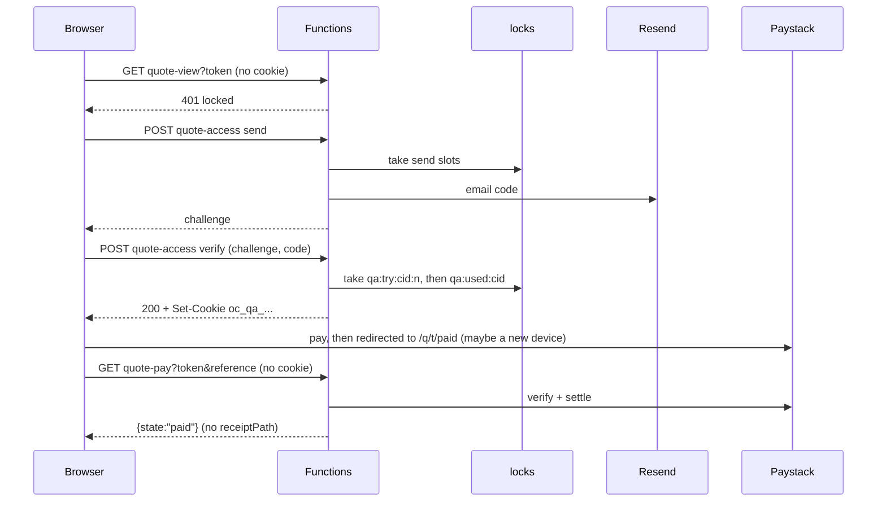

# Quote link email-code gate: design (accepted, 2026-10-20)

## Owner decisions (2026-10-20)

These override the proposal below wherever the two differ; the sections below are updated to match.

- A 6-digit code is emailed to the client email on the quote. It is valid for 10 minutes, allows 5 tries and works once. A correct code unlocks the browser for 30 days, not sliding.
- The quote, pay and stage-invoice pages are gated behind the quote link. Signed receipts are unchanged.
- A later payment request (`requestStage`, which issues a fresh link) does **not** need a new code: the unlock survives it. Only Revise and the admin "New link" (`rotate`, the leak response) lock every browser. See "Session binding" below.
- The code screen shows a masked email: the first character, five dots and the domain ("p•••••@hotmail.com").
- The owner gets one email when a code locks out after 5 wrong tries (once per challenge).
- Kill switch: `QUOTE_ACCESS_GATE=off` restores today's link-only behaviour.
- The code goes in the email subject.
- A quote with no client email can't be unlocked; the screen says to contact hello@oceaniccoder.dev.

## Problem

Anyone holding a `/q/<token>` link (forwarded email, shared WhatsApp chat, shoulder-surfed screen) sees the client's name, email, scope and amounts, and can accept or start a payment. Owner decision: the link must also need a 6-digit code emailed to `quote.clientEmail` (10 min, 5 tries); after a correct code the browser stays unlocked for 30 days. The 256-bit link token, signed receipts and the Paystack webhook stay as they are. Has to work on Appwrite (production today) and Cosmos (cutover ~28 Oct, Appwrite gone ~1 Nov).

**Non-goals:** admin auth changes, accounts for clients, SMS, changing receipt links, changing when links rotate.

## What exists (read on main 55558b9 and origin/feat/OC-0-cosmos-quotes)

- The client endpoints find the quote by `hashToken(token)` and have no other check: `api/quote-view/index.js:15-35`, `api/quote-pay/index.js:26-31` (POST start, GET check), `api/quote-respond/index.js:156-170`. `api/quote-receipt` uses the HMAC `verifyReceipt` (`api/shared/tokens.js:28-41`) and does not use the link.
- The link changes on `send`, `rotate`, `emailAgain` and `requestStage` (each writes a new `tokenHash`), and `revise` clears it and bumps `revision` (`api/quote-admin/actions.js`). Binding a session to `tokenHash` + `revision` would therefore drop it on every new link, which the owner ruled out for `requestStage` (see "Session binding").
- `svc.locks.take/release` (`api/shared/locks.js`) creates an id that must not already exist, so exactly one caller wins. That holds on Appwrite, and on Cosmos through `createCosmosLocks` in #201. `services.js` on #201 picks the backend, so code that only uses `svc.locks` and `svc.repo` works on both.
- The in-memory limiter `createRateLimiter` (`api/visit/index.js:71-86`) counts per instance. SWA scales out, so its counts are not global.
- **Gotcha:** `?preview=1` is not an admin signal. `CheckoutPage.tsx:44` and `StageInvoicePage.tsx:9` always pass `preview=true` to skip `viewedAt`, and anyone can add it to a URL. The admin "Preview" link is `${link}?preview=1` (`QuoteSidebar.tsx:208`, `QuoteEditor.tsx:628`). The in-dashboard "Preview as client" uses `quoteAdmin("clientView")`, needs no link token and is not affected.
- Admin auth: on main it is an Appwrite JWT (`api/shared/adminAuth.js`, sent by `adminHeaders.ts`). #199 adds the SWA GitHub principal, a same-origin cookie, and `requireAdmin` accepts both.
- The Cosmos database is near its 25-container limit (docs/plans/2026-10-12-admin-analytics-design.md), so a new container is expensive. On Appwrite a new table or column is a console change.
- Paystack `callbackUrl` is `/q/<token>/paid?reference=`. `PaidPage` polls `GET /api/quote-pay`, which **settles** through `handleQuoteCharge`, the same path the webhook uses (`quote-pay/index.js:107-117`).

## Options for challenge state

|                                    | A. Fields on the quote row                                                        | B. Signed challenge + attempt slots in `locks` (rec.)                       | C. Signed challenge + in-memory counts     |
| ---------------------------------- | --------------------------------------------------------------------------------- | --------------------------------------------------------------------------- | ------------------------------------------ |
| Correct 5-try cap across instances | No: Appwrite update is read-modify-write, so parallel guesses all read `tries=4`  | **Yes**: try _n_ = `locks.take("qa:try:<cid>:<n>")`, n=1..5                 | No: 5 x instances, and a restart resets it |
| Schema work                        | Appwrite console columns + Cosmos import mapping                                  | **None** (the locks table exists on both)                                   | None                                       |
| Risk to money state                | Writes the row settle/webhook write; on Cosmos etag retries contend with payments | None (separate table)                                                       | None                                       |
| Cleanup                            | Overwritten                                                                       | Lock rows have no TTL: ~3 per send, up to 6 per challenge, a few KB a month | n/a                                        |
| Work and reversibility             | Medium; leaves a schema behind                                                    | Low; delete the code                                                        | Lowest, but does not meet the requirement  |

**Deciding factor:** a 5-try limit that holds across instances on both backends without a schema change. B is the only option that gives it. A also couples auth state to the row that money moves through.

## Decision

**B.** The challenge is a stateless HMAC token. Attempts and send quotas are slots in the existing `locks` table. The unlock is an HttpOnly cookie bound to quote id + revision + access epoch (see "Session binding"). A new secret, `QUOTE_ACCESS_SECRET`, fails closed when missing.
_What would change my mind:_ if SWA does not pass `Set-Cookie` or `Cookie` through to managed Functions (spike R1), the session moves to a signed bearer in localStorage (table below). If lock-row growth matters on Cosmos, add an optional `ttl` to `createCosmosLocks` later.

## Design

**Shared module `api/shared/quotes/access.js`** (pure apart from `svc.locks`, `sendEmail` and the clock):

- `secret()`: returns `QUOTE_ACCESS_SECRET` if it has 32 or more characters; otherwise throws `HttpError(503, "Quote links are unavailable right now.")` and logs an error once. Not shared with `RECEIPT_SIGNING_SECRET`: rotating this secret signs out every browser, while rotating the receipt secret would break every receipt link, which never expires. All HMACs carry a domain label (`qa-chal:`, `qa-code:`, `qa-sess:`).
- **Challenge** `v1.<b64url{c,q,r,e,m,x}>.<hmac>`. `c` is a random 128-bit id, `q` the quote id, `r` the revision, `e` the access epoch, `m` a keyed tag of the client email the code went to (HMAC under `QUOTE_ACCESS_SECRET`, so a token holder can't confirm a guessed address offline), `x` = now + 10 min. A rotate, a revise or a change of client email therefore voids a pending code. Code = `HMAC(secret, "qa-code:"+cid)` taken as a uint32 mod 10^6, zero-padded. No code material sits in the token or the database. Compared with `timingSafeEqual`.
- **Verify:** check the signature, `exp` and the binding against the current quote. Then take the first free slot `qa:try:<cid>:1..5`. If all five are taken, answer 429 "Too many tries. Ask for a new code." If the code is wrong, answer 400 `{triesLeft}`. If it is right, `take("qa:used:<cid>")` (single use; losing it means 409). Then set the session cookie. The fifth wrong try answers 429 at once and emails the owner (`accessLockedAlert`, once per challenge because only one request can hold slot 5).
- **Session cookie** `oc_qa_<16 hex of sha256("qa-name:"+quoteId)>` = `v1.<b64url{q,r,e,m,x}>.<hmac>`, `HttpOnly; Secure; SameSite=Strict; Path=/api; Max-Age=2592000`. `Path=/api/quote-` (the first draft) would not work: a cookie path only matches at a `/` boundary (RFC 6265 5.1.4), so it would never reach `/api/quote-view`. The name is per quote rather than per link, so it survives a payment request's fresh link, and one browser can hold several quotes. `hasAccess(svc, req, quote)` = signature valid, `x` > now, `q` and `r` equal the stored quote, `m` matches the current client email, and `e` is still the current epoch. Not sliding: it expires 30 days after the code was entered.
- **Session binding (owner decision: survive `requestStage`, die on `rotate` and `revise`).** `revise` already bumps `revision`. `rotate` writes only `tokenHash`, exactly as `requestStage` and `emailAgain` do, so nothing on the quote row tells them apart, and the owner ruled out a new quote field (an Appwrite console change). The epoch therefore lives in `locks`: `rotate` takes the next free slot `qa:epoch:<quoteId>:<revision>:<n>`, and the current epoch is the number of slots taken (0 for a quote never rotated). A cookie with epoch `e` is valid while slot `e+1` is absent. Checking that needs a read, so the locks interface gains `has(key)` (Appwrite `getDocument`, Cosmos `item(id, id).read()`); `take` alone can't test for a row without creating it, which would either revoke the epoch it is checking or, after a rotate, briefly bring a revoked epoch back for a concurrent request. `rotate` takes its slot before it writes the new link, so a failed lock write leaves the old link and every session in place instead of a new link with sessions still open. `emailAgain` to the same address behaves like `requestStage` and keeps sessions. Changing the client email (`emailAgain` with a saved new address) ends every unlock and pending code, because both carry the keyed email tag: an unlock earned through the old address should not outlive it (security review, 2026-10-20). This was chosen over bumping the epoch on every email change because it needs no write in `emailAgain` or any other path that may change the address. Cost: one lock read per gated request, up to a few more when a code is verified.
- **Send quotas** (global, through locks): one per quote per minute (`qa:send:<id>:<minute>`), 5 per hour, 10 per UTC day (`…:<hour|day>:<1..n>`). On top, a per-instance IP limit of 10 sends an hour and 30 verifies per 10 min, using `createRateLimiter` moved to `api/shared/rateLimit.js`. If Resend fails, the minute slot is released and the answer is 502. **No Turnstile in v1:** the recipient is fixed and the caps bound the volume, while a widget in in-app browsers would add a failure on the way to paying. Revisit if the logs show abuse. Worst case for a guesser: 50 guesses per quote per day, about 0.15% over 30 days, and every challenge emails the real client.

**New function `POST /api/quote-access`** `{action:"send", token}` returns `{challenge, retryAfterSeconds}`. `{action:"verify", token, challenge, code}` returns `{ok:true}` + Set-Cookie. Sending is a user-initiated POST only, never on page load or GET, so mail scanners that open links never trigger a code.

**Gated endpoints**: lookup, then 404 inactive (unchanged), then the gate, then everything else:

- `GET quote-view`. `viewedAt` is set only after unlock. `POST quote-pay` (start). `POST quote-respond`.
- Locked answer: `401 {locked:true, error:"Enter the code we email you to open this quote."}`. It carries nothing from the quote.
- **Ungated on purpose:** `GET quote-pay` check still verifies with Paystack and settles, and returns `{state}`. It returns `receiptPath` only with a session or an admin. Money state never waits on the gate. The webhook and `quote-receipt` are unchanged.

**Admin bypass:** the page sends `admin=1` only when the URL has `?preview=admin` (the sidebar and editor links change to this). The server runs `requireAdmin` only when no session is present **and** `admin=1` is set. On success it bypasses the gate, sets no cookie and does not touch `viewedAt`. This works with the Appwrite JWT on main (`adminHeaders()` attached when `preview=admin`) and with the SWA cookie after #199. `preview=1` keeps its old meaning, "do not mark viewed", and bypasses nothing.

**Frontend:** `useClientQuote` gets a `{kind:"locked"}` state. The new `QuoteAccessGate.tsx` renders inside `QuoteShell title="Open your quote"`: wordmark, "OceanicCoder", one line of copy and an "Email me a code" button. It shows no client name or amounts. It shows the masked email the code goes to (owner decision), and for a quote with no client email it says the quote can't be opened with a code and to contact hello@oceaniccoder.dev. `POST /api/quote-access {action:"status", token}` gives the page `{locked, canUnlock, maskedEmail}`. CheckoutPage, StageInvoicePage and QuoteActions show the same gate on a 401 locked answer, then reload. PaidPage keeps polling while locked, shows "Payment received. We've emailed your receipt." and offers "Open your quote" (which leads to the gate). The challenge is kept in sessionStorage per link, so a refresh does not lose it.
**Accessibility:** one `<input type="text" inputMode="numeric" autoComplete="one-time-code" pattern="[0-9]*" maxLength={6}>` with a visible label "6-digit code". Pasted spaces and dashes are stripped. Errors and tries left are linked with `aria-describedby` and announced through `role="alert"`. "Code sent" goes through `role="status"`. Focus moves to the input after sending. The resend button is disabled with a visible "Resend in 0:45" that is not announced every second. No auto-submit.
**Email** (`quoteEmails.accessCode`, the `ui.js` kit, plus a catalog/preview entry). Subject: "123456 is your code for quote Q-2026-0004". Body: "Hi Kofi, use this code to open your quote from OceanicCoder: **123456**. It works for 10 minutes. If you didn't try to open it, ignore this email; nobody can open the quote without the code." There is no link in the email, and a text part goes with it.
**Logging:** `quote-access send|verify|lock|limit quote=<quoteNumber> triesLeft=<n>` only. It never logs the code, challenge, cookie, link token, email or raw IP. Floods use the once-per-key alerter pattern.

**Session transport considered:** an HttpOnly cookie (chosen) cannot be read by XSS, persists 30 days (ITP leaves server-set first-party cookies alone) and CSRF is moot because every request also needs the link token in its query or body. A bearer token in localStorage is readable by any XSS, Safari ITP clears it after 7 days without interaction, and every fetch has to add it. It is the fallback only if R1 fails.

## Rollout and PR split (each PR under 24 files)

1. **PR A, additive, on main:** `access.js` + test, `rateLimit.js` (+ visit import, the same commit as on feat/OC-0-submit-contact-email), `locks.has` (+ fake), the epoch slot in `rotate`, `api/quote-access/*` (`send`, `verify`, `status`), the `accessCode` email and the `accessLockedAlert` admin email + tests, catalog/samples, the CLAUDE.md env rows (`QUOTE_ACCESS_SECRET`, `QUOTE_ACCESS_GATE`). When the Cosmos stack rebases, `createCosmosLocks` needs the same `has`. Nothing is gated yet. Set `QUOTE_ACCESS_SECRET` in Azure **before** merging. Run spike R1 on its preview environment.
2. **PR B, enforce + UI, on main:** quote-view/pay/respond + tests, `QuoteAccessGate.tsx` + test, `useClientQuote`, the Quote pages, `services/api/quotes.ts`, `types/quote.ts`, the sidebar and editor preview links (about 16 files). Verify in a real browser on the preview environment.
3. **Order:** land A and B on main before the cutover freeze (target 24 Oct), then rebase #199, #201, #204-#206. The stack does not touch quote-view, quote-pay or quote-respond, and the gate does not touch `service.js`, `locks.js`, `notify.js` or `actions.js`, so conflicts should be small. After the rebase, add an access test over `createCosmosLocks` with `fakeCosmos`. If A and B are not merged by 26 Oct, ship them after the cutover rather than stacking them on #201.
   **Rollback:** revert PR B. Kill switch: `QUOTE_ACCESS_GATE=off` disables enforcement (unset means on; any other value throws, like `WRITE_HOLD`). This is for a Resend outage. Cutover import: copying `qa:*` lock rows is harmless.

## Risks and open questions

| #   | Risk / question                                                                                                  | Owner    | Retire by                                                                                        |
| --- | ---------------------------------------------------------------------------------------------------------------- | -------- | ------------------------------------------------------------------------------------------------ |
| R1  | SWA may not forward `Set-Cookie` or `Cookie` for managed Functions (v3 `context.res.cookies`)                    | engineer | Spike on PR A's preview environment                                                              |
| R2  | A Resend outage or the spam folder blocks clients from paying                                                    | owner    | Kill switch, resend button, "reply to this email" copy                                           |
| R3  | In-app browsers (WhatsApp, Instagram) keep their own cookie jar, so the client may enter a code again            | accepted | PaidPage never needs the gate                                                                    |
| R4  | Appwrite lock latency: up to 6 creates on a verify                                                               | engineer | Measure on preview                                                                               |
| Q1  | `requestStage` rotates the link, so every payment request needs a new code. OK?                                  | owner    | Decided: no new code; sessions bind to an epoch that only `rotate` and `revise` change           |
| Q2  | Show a masked email ("k•••@gmail.com") on the gate? Default: no                                                  | owner    | Decided: yes, first character + five dots + domain                                               |
| Q3  | Code in the subject line? Default: yes                                                                           | owner    | Decided: yes                                                                                     |
| Q4  | Email the admin when a challenge locks out (at most once per quote per day)? Default: log only                   | owner    | Decided: one email per locked-out challenge                                                      |
| Q5  | Sent quotes with an empty `clientEmail` from before `sendError` checked it: show "Contact us to open this quote" | engineer | Decided: they can't be unlocked; the screen names hello@oceaniccoder.dev. Count them before PR B |

## Acceptance criteria

- Given a valid link and no cookie, when the client opens `/q/<t>`, `/pay/<s>` or `/invoice/<s>`, then they see only the gate (wordmark, business name), and quote-view, quote-pay POST and quote-respond answer 401 `locked` with no quote fields.
- Given the gate, when "Email me a code" is pressed, then one email goes to `quote.clientEmail`, and a second press inside 60 s, the 6th in an hour or the 11th in a day answers 429 without emailing.
- Given a challenge, when 10 verifies arrive in parallel across instances, then at most 5 are evaluated and the rest answer 429.
- Given a correct code within 10 minutes, then the cookie is set and the pages load. Reusing the same code answers 409. A code after 10 minutes is refused.
- Given an unlocked browser, when the admin rotates or revises, then the next request through the old or new link answers 401 locked.
- Given an unlocked browser, when the admin requests a stage or emails the quote again, then the new link opens without a code.
- Given 30 days after unlock, then the gate shows again.
- Given a client returning from Paystack on a new device, then PaidPage shows the paid state, the payment is settled and recorded, and no `receiptPath` is returned.
- Given `?preview=1` without an admin session, then nothing is bypassed. Given `?preview=admin` with an admin session, then the quote shows, no cookie is set and `viewedAt` is unchanged.
- Given `QUOTE_ACCESS_SECRET` unset or shorter than 32 characters, then the gated endpoints and quote-access answer 503, and the Paystack check and webhook still settle.
- Given any run, then the logs contain no code, token, cookie, email or raw IP.
- The code input has a label, `autocomplete="one-time-code"` and `inputmode="numeric"`, errors are announced and it passes an axe check. Both backends pass the access tests.

## ADR-quote-access: email code gate on client quote links

- Status: proposed. Date: 2026-10-20. Deciders: owner. Ticket: OC-0.
- **Context:** the bearer link alone exposes quote data. A code was required (owner). Two backends during the cutover; no schema changes wanted; SWA scales out.
- **Decision:** a stateless HMAC challenge, global attempt and send slots in `locks`, an HttpOnly per-quote session cookie bound to id + revision + an access epoch kept in `locks` (only rotate and revise change it), and a dedicated `QUOTE_ACCESS_SECRET` that fails closed. Settlement paths stay ungated.
- **Options:** quote-row fields (racy on Appwrite, schema work, touches money rows); in-memory counts (not global); a localStorage bearer (XSS, ITP).
- **Consequences:** + no schema changes, works on both backends, a payment request keeps the client signed in, rotate and revise lock everyone. - lock rows accumulate without a TTL; the locks interface gains a read (`has`), which the Cosmos locks must implement too; one lock read per gated request; in-app browsers ask again.
- **Revisit when:** abuse shows in the logs (add Turnstile), clients get accounts, or locks get a TTL.
