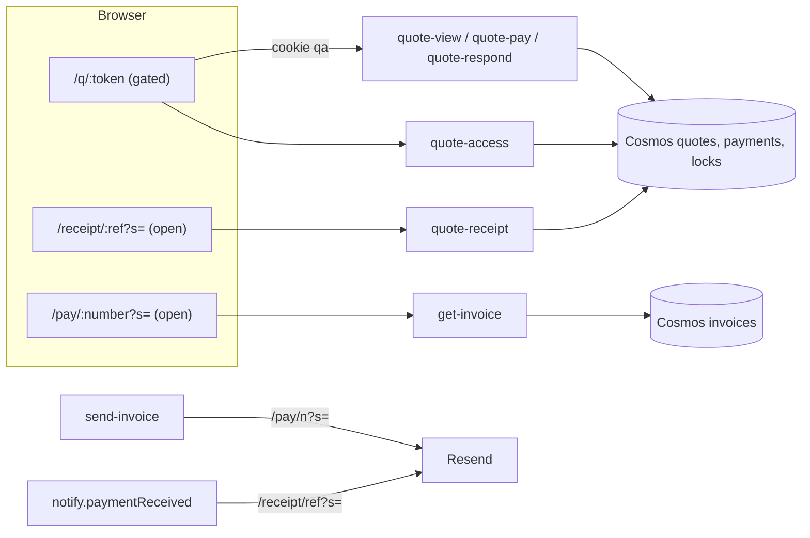
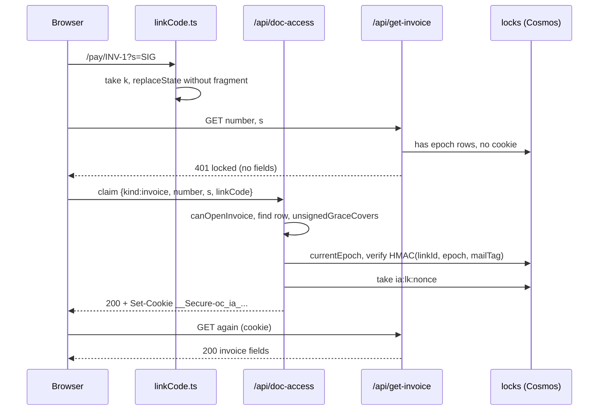
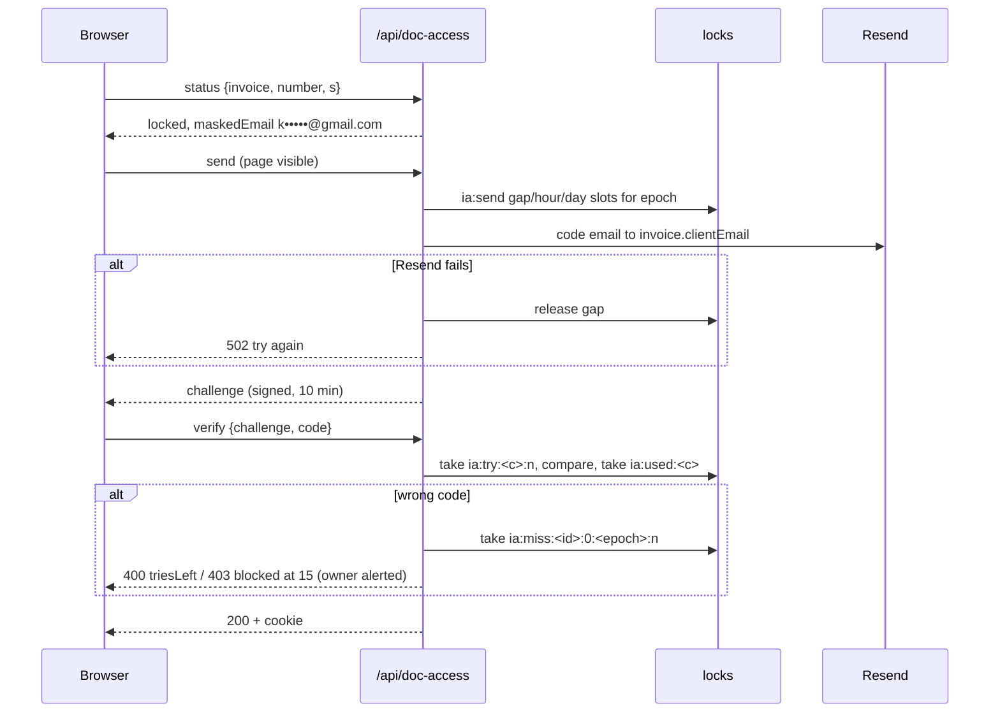
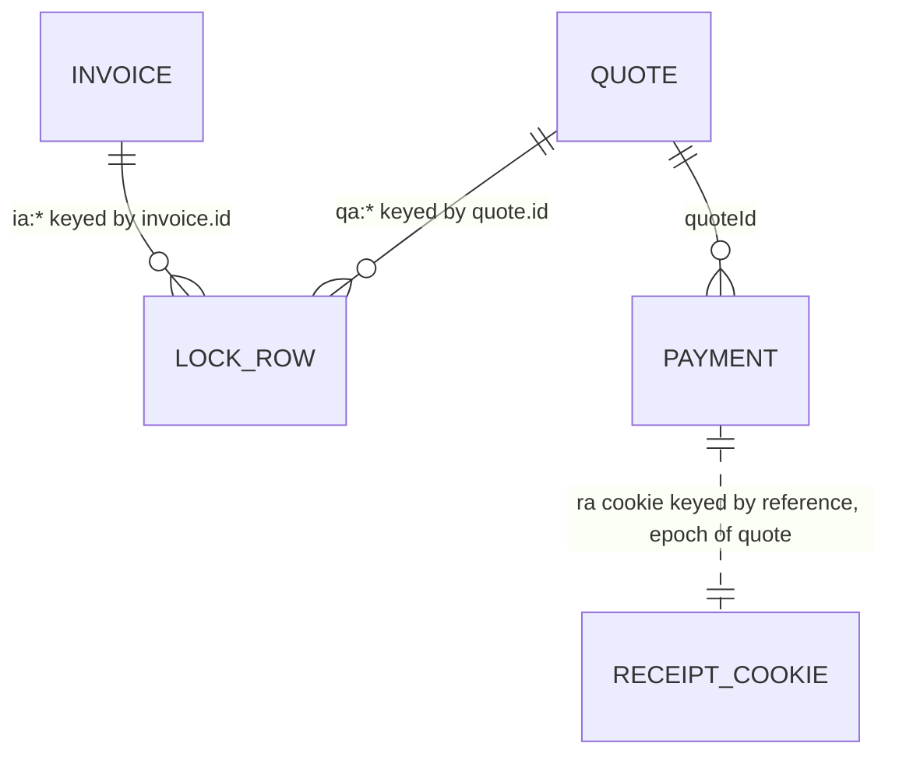

# Design: emailed access code for invoice pay pages and receipt pages

Status: approved by the owner 2026-10-25
Owner: Illona Addae Date: 2026-10-25 Ticket: OC-0
Read against `origin/main` at 6e247da. File references are to that commit.

## 1. Problem

Anyone holding a `/pay/<invoiceNumber>?s=...` link or a `/receipt/<ref>?s=...` link (forwarded email, shared chat, old inbox) sees the client's name, email and amounts, and on `/pay/` can start a payment. Quote pages already need a second factor (PR #211); invoices and receipts do not, which breaks the global rule "A link is not a lock".

## 2. Goals and non-goals

Goals (owner decisions 2026-10-25, fixed):

- Same rule as quotes on `/pay/<n>` and `/receipt/<ref>`: an emailed link carries a one-time link code (`#k=`) and opens at once; anywhere else the page asks for a 6-digit code emailed to the client's address on the record; the browser is then trusted for 30 days.
- Every link already sent keeps working (signed `?s=` invoice links, unsigned invoice links in the grace window to 2026-11-21, signed receipt links), but goes through the code step. Nobody needs a new link.
- Nothing private (name, email, amounts, status, dates) leaves the server before an unlock or an admin session.
- Revoking access ends every unlock and every unclaimed link code.

Non-goals:

- Client accounts, SMS codes, changing quote-page behaviour.
- Changing the `/pay/` or `/receipt/` URL format or the `?s=` signing scheme.
- Gating the Paystack webhook, `quote-pay` GET, or the one-off invoice "paid" emails (they carry no link).
- Fixing invoice-number collisions (reported in section 10, not fixed here).

## 3. Constraints and assumptions

- Stack: Azure Functions (classic, CommonJS) on Cosmos; `locks` container for counters (`api/shared/locks.js`), which needs Session or Strong consistency (comment at `locks.js:21-28`). No new service, no new dependency.
- `QUOTE_ACCESS_SECRET` is set in production (≥ 32 characters, confirmed 2026-10-21 per PR #211). Assumed reusable with new domain labels (section 8.1).
- Resend click tracking is off (PR #211). Must stay off or `#k=` links leak into Resend's redirector.
- One owner, one developer. PRs must stay under about 24 files.
- Unconfirmed: whether any one-off invoice row lacks `clientEmail` (imported from Appwrite). The design handles it (contact message), but the count is unknown. Check with one Cosmos query before PR 4.

## 4. Context: how it works today

### 4.1 Quote gate (the thing to reuse)

- `api/shared/quotes/access.js` (554 lines). Stateless HMAC tokens with domain labels `qa-chal:`, `qa-code:`, `qa-sess:`, `qa-mail:`, `qa-link:` (`:86-112`, `:124-127`, `:191-194`, `:349-355`, `:465-475`). Counters as lock rows with prefix `qa:`: epoch `qa:epoch:<quoteId>:<rev>:<n>` (`:164-186`), tries `qa:try:` (`:235-240`), single use `qa:used:` (`:243`), send quotas `qa:send:<id>:<rev>:<epoch>` 60 s gap / 5 h / 10 day (`:257-322`), wrong-code block `qa:miss:` at 15 (`:324-339`), link-code markers `qa:lk:<nonce>` (`:388-390`). Retention prune `pruneAccessLocks` (`:422-452`) run by `api/quote-maintenance-due/index.js:72`; it skips non-`qa:` rows.
- Concepts the module reads from a quote: `id`, `revision`, `tokenHash` (link binding for link codes, `:353`), `clientEmail` (mail tag, `:124`), `quoteNumber` (logs only, in callers).
- Cookie: `__Secure-oc_qa_<sha256("qa-name:"+quoteId)[0:16]>`, `Path=/api; HttpOnly; Secure; SameSite=Strict`, 30 days, not sliding (`:455-475`).
- Kill switch `QUOTE_ACCESS_GATE` (`:62-71`); missing secret fails closed with 503 (`:74-84`).
- `api/quote-access/index.js`: POST `status | claim | send | verify`, per-instance IP limits (10 sends/h, 30 verifies/10 min), lockout alert to the owner (`:151-170`), logs only the quote number.
- `requireAccess` (`access.js:504-510`) and `adminCheck` (`:517-523`) used by `api/quote-view/index.js:30-38`: session first, admin check only when the page sent `admin=1`.
- Frontend: `src/utils/quoteLinkCode.ts` captures `#k=` before React and before any third-party script, only for `/q/<token>` (`:26`). `src/components/Quote/QuoteAccessGate.tsx` is the code screen; it is quote-specific in copy ("Open your quote"), storage key (`oc-quote-code:<token>`) and API calls (`fetchQuoteAccess`, `sendQuoteCode`, `verifyQuoteCode` in `src/services/api/quotes.ts`).
- Link codes are minted per email in `api/quote-admin/actions.js:31-39` (`linkCodes`) and passed through `api/shared/quotes/notify.js` into `views.js` `clientLink` (`views.js:70-72`). Admin-visible links never carry a link code (`rotate`, `actions.js:200-215`).
- Code email `accessCode` and admin alert `accessLockedAlert` in `api/shared/email/quoteEmails.js:380-430`, catalog entries `accessCode` and `accessLockedAlert` in `api/shared/email/catalog.js:132-137, 347-352`.

### 4.2 One-off invoices (`/pay/<n>`)

- Link: `/pay/<number>?s=<HMAC("invoice:"+number, RECEIPT_SIGNING_SECRET)[0:32]>` (`api/shared/invoiceLinks.js:22-24`, `api/shared/tokens.js:30-50`). Deterministic per invoice number, so it can't be rotated or revoked today.
- Grace: an unsigned `/pay/<n>` opens until 2026-11-21 for an unpaid invoice created before 2026-10-28 (`invoiceLinks.js:11-45`).
- `api/get-invoice/index.js`: per-instance IP limit 30/10 min (`:34`), signature check before lookup with one 404 body for every failure (`:87-104`), returns `invoiceNumber, clientName, clientEmail, total, currency, status, dueDate, estimatedDelivery` (`:107-116`). No DI (`module.exports = async function`), reads `process.env` directly.
- `src/components/Payment/PaymentPage.tsx`: reads `?s=`, calls `get-invoice`, then pays with Paystack Inline in the browser using `invoice.clientEmail` (`:467-512`). No server-side "start payment" call exists, so the only gate point is `get-invoice`.
- Sending: `src/components/AdminDashboard/tabs/ClientWork/InvoiceModal.tsx:111-166` saves the invoice row first, then POSTs the email fields (including `clientEmail` from the inquiry) to `api/send-invoice/index.js`, which renders and sends with the body's fields and never reads the row (`:218-291`). The pay link is built at `send-invoice/index.js:97`.
- Admin: `InvoicesTab.tsx:303-322` "View pay page" asks `quoteAdmin("invoicePayLink")` (`api/quote-admin/actions.js:428-436`) and opens the bare signed link; "Copy pay link" copies it.
- Row shape (Cosmos `invoices`, partitioned by id): `id`, `invoiceNumber`, `clientName`, `clientEmail`, `clientPhone`, `items`, `total`, `currency`, `status` (`sent`/`paid`/...), `archivedAt`, `createdAt` or `$createdAt` (imported). Read helpers in `api/shared/invoices/store.cosmos.js:46-58`.

### 4.3 Receipts (`/receipt/<ref>`)

- Receipts exist only for quote payments: `api/quote-receipt/index.js:16-26` verifies `?s=` (`signReceipt`, `tokens.js:46`), requires `payment.kind === "quote"` and `status === "success"`, loads the quote, returns `receiptView` (client name, company, amount, method, quote title, stage, balance; `views.js:326-343`). One-off invoice payments have no receipt page (their emails carry no link).
- Receipt links are emailed in the quote payment receipt (`notify.js:60-72` via `views.js:415-436`) to `p.clientEmail || q.clientEmail`. `p.clientEmail` is the address the payer typed on the checkout page (`quote-pay/index.js:41-43, 83`), so it can differ from the quote's client email.
- `quote-pay` GET returns `receiptPath` only to an unlocked quote session or admin (`quote-pay/index.js:118-130`), so in-app receipt links are already behind the quote gate. `ReceiptPage.tsx:16-20` calls `fetchReceipt(reference, s)`.



## 5. Options

The central choice is how to reuse `quotes/access.js`. A second choice (receipt unlock scope) is folded into each option's design and decided in 8.4.

### Option A (recommended): extract a record-agnostic access core; quotes, invoices and receipts are bindings

- New `api/shared/access/core.js`: `createAccess(scheme)` returns the same functions `quotes/access.js` exports today, but over a `subject` instead of a quote. A `scheme` fixes the HMAC label prefix, the lock-row prefix, the cookie prefix, the gate variable and the 503 text.
- `api/shared/quotes/access.js` becomes a thin binding over the quote instance of the core, exporting the same names and signatures so no caller changes. `QUOTE_SCHEME` (with its `subject` mapping) and that one instance, `createAccess(QUOTE_SCHEME)`, live in `api/shared/quotes/accessScheme.js`. Golden tests pin today's exact outputs (cookie name, cookie value, challenge, link code, lock keys) for a fixed secret and clock, recorded from the current code before the refactor, so every live quote cookie, sent `#k=` code and lock row keeps working.
- The `quote-access` handler body (status, claim, send, verify, lockout alert, IP limits) moves to `api/shared/access/endpoint.js` as `createAccessEndpoint({ access, locator, emails, labels })`, where `locator` is `{ check(body), find(svc, body) }`. `quote-access` keeps its route and contract and becomes a locator plus wiring. A new `api/doc-access` function serves invoices and receipts with its own locators.
- `api/shared/invoices/access.js` and `api/shared/receipts/access.js` are bindings.
- Frontend: `QuoteAccessGate` becomes a wrapper over a new `DocumentAccessGate` that takes an `AccessTarget` (API calls, storage key, copy). `quoteLinkCode.ts` generalises to `linkCode.ts` matching `/q/`, `/pay/` and `/receipt/`.

Cost: one refactor PR with no behaviour change, then additive PRs. About 900 changed lines over 5 PRs.
Risk: the refactor silently changes a label or key and signs everyone out, voids sent link codes, or frees used-link markers. Retired by golden tests and by running the existing quote suites unmodified.
Failure modes: same as quotes today (secret missing: 503 fail closed; lock store unreachable: 500 and nothing opens; Resend down: 502 and the gap slot is handed back).
Reversibility: each kind has its own kill switch; the refactor itself is reversible by revert with no data change (no stored format changes).

### Option B: wrap `quotes/access.js` unchanged with a quote-shaped adapter

- `invoices/access.js` builds a fake quote `{ id: "inv:"+invoice.id, revision: 0, tokenHash: "pay:"+number, clientEmail, quoteNumber: number }` and calls the quote functions directly. Receipts pass the real quote. A copy of `quote-access` (renamed) serves invoices.

Cost: smallest diff for invoices (no refactor), about 2 new backend files plus a copied endpoint.
Risks, concretely:

- Separation of a quote unlock from an invoice unlock rests only on the `inv:` id prefix: the HMAC labels (`qa-sess:`, `qa-link:`, `qa-mail:`) and cookie prefix are shared. Any future change that drops or normalises the prefix makes a quote cookie verify as an invoice cookie when ids collide.
- `pruneAccessLocks` (`access.js:422-452`) calls `repo.get(quoteId)` for `qa:miss:` rows; for `qa:miss:inv:...` it gets null, treats the invoice as superseded and deletes live wrong-code counters, which resets the 15-miss block daily. The prune must then learn about the prefix anyway.
- `quoteNumber`, the "Quote links are unavailable" 503 text, the `QUOTE_ACCESS_GATE` switch and the quote code email all leak into invoice behaviour; one kill switch for all three kinds.
- A second copy of the endpoint (about 240 lines) breaks "one way to do a thing" and will drift.
  Reversibility: easy to remove, but the shared namespace is hard to separate later because cookies and rows are already in it.

### Option C: smallest change, do nothing beyond what exists

Keep `?s=` as the only check. Violates the owner decisions and the global rule; listed for completeness. A middle variant (gate only `/pay/` with a copied quote gate, leave receipts) also contradicts decision 2.

## 6. Comparison

| Criterion              | A: shared core                                                | B: adapter over quote module                         | C: nothing          |
| ---------------------- | ------------------------------------------------------------- | ---------------------------------------------------- | ------------------- |
| Correctness and fit    | Meets all three decisions; separate kill switches             | Meets them, but prune bug unless patched; one switch | Fails decisions 1-2 |
| Cross-record isolation | By HMAC label, cookie prefix and id                           | By id prefix only                                    | n/a                 |
| Complexity             | One refactor, then small bindings                             | Fewer files now, copied endpoint                     | none                |
| Operability            | One prune, one log format, per-kind switch                    | Shared switch, mixed rows under `qa:`                | n/a                 |
| Security               | Domain separation is structural                               | Relies on a string convention                        | Link is the lock    |
| Performance            | Same lock reads as quotes (1-3 point reads per gated request) | Same                                                 | Fewer reads         |
| Cost                   | ~5 PRs                                                        | ~3 PRs                                               | 0                   |
| Reversibility          | Per-kind switch off; revert refactor safely                   | Switch off turns quotes off too                      | n/a                 |
| Team fit               | Same JS patterns, tests extend existing suites                | Same                                                 | n/a                 |

Deciding factor: isolation and the prune. Option B's separation of a quote unlock from an invoice unlock is a naming convention inside shared labels, and its prune deletes live invoice counters. Option A makes the separation structural at the cost of one no-behaviour-change refactor that golden tests can pin.

## 7. Recommendation

Option A. It reuses every rule PR #211 already proved (single use, tries, quotas, epochs, retention), gives each record kind its own labels, cookies, rows and kill switch, and leaves quotes byte-for-byte unchanged.

What would change my mind: if the golden tests show that quote outputs can't be reproduced exactly through the core (for example a label is built differently in one place), I would keep `quotes/access.js` as is and build the core beside it for invoices and receipts only, accepting a second copy of the primitives until quotes can move.

## 8. Design

### 8.1 Components and responsibilities

| Component                                                    | Responsibility                                                                                                                                        | New or changed                      |
| ------------------------------------------------------------ | ----------------------------------------------------------------------------------------------------------------------------------------------------- | ----------------------------------- |
| `api/shared/access/core.js`                                  | `createAccess(scheme)`: challenge, code, link code, session cookie, epoch, tries, quotas, misses, prune, `requireAccess`, `adminCheck`, `maskEmail`   | new (moved from `quotes/access.js`) |
| `api/shared/quotes/access.js`                                | Binding: same exports and arguments as today, over the quote instance of the core                                                                     | changed (thin)                      |
| `api/shared/quotes/accessScheme.js`                          | `QUOTE_SCHEME` (with its subject mapping) and the one quote instance of the core, which `quote-access` passes to the endpoint                         | new (PR 1)                          |
| `api/shared/invoices/access.js`                              | Binding: `INVOICE_SCHEME`, `invoiceSubject`; the invoice locator (`check`, `find` on `{number, s}`) applying `canOpenInvoice` + `unsignedGraceCovers` | new                                 |
| `api/shared/receipts/access.js`                              | Binding: `RECEIPT_SCHEME` (`prunes: false`), `receiptSubject(quote, payment)`; the receipt locator (`check`, `find` on `{reference, s}`)              | new                                 |
| `api/shared/access/endpoint.js`                              | The four actions, IP limits, lockout alert, redacted logs, generic over a locator (`check`, `find`); log tag defaults to the scheme's `logTag`        | new (moved from `quote-access`)     |
| `api/quote-access`                                           | Route unchanged; locator = token lookup                                                                                                               | changed (thin)                      |
| `api/doc-access`                                             | POST `{kind:"invoice"\|"receipt", ...locator, action}`                                                                                                | new                                 |
| `api/get-invoice`                                            | Locator check, then `requireAccess` (invoice), admin preview                                                                                          | changed                             |
| `api/quote-receipt`                                          | Locator check, then quote session OR receipt session OR admin                                                                                         | changed                             |
| `api/send-invoice`                                           | Reads the invoice row, sends to the row's email, mints the link code                                                                                  | changed                             |
| `api/shared/quotes/notify.js`, `views.js`                    | Receipt email link gets a receipt link code                                                                                                           | changed                             |
| `api/quote-admin/actions.js`                                 | `resetInvoiceAccess`; `invoicePayLink` returns the preview flag                                                                                       | changed                             |
| `api/quote-maintenance-due`                                  | Prune runs over `qa:` and `ia:` rows (receipts share `qa:`)                                                                                           | changed                             |
| `api/shared/email/quoteEmails.js` (or new `accessEmails.js`) | `accessCode` and `accessLockedAlert` take a document kind                                                                                             | changed                             |
| `src/components/Access/DocumentAccessGate.tsx`               | Generic code screen                                                                                                                                   | new (moved from `QuoteAccessGate`)  |
| `src/utils/linkCode.ts`                                      | Captures `#k=` for `/q/`, `/pay/`, `/receipt/`                                                                                                        | changed from `quoteLinkCode.ts`     |
| `PaymentPage.tsx`, `ReceiptPage.tsx`, `InvoicesTab.tsx`      | Locked state, admin preview, Reset access                                                                                                             | changed                             |

Scheme validation (PR 1): `createAccess` throws at load unless `label`, `rows` and `cookie` are each 2 to 8 lowercase letters and `subject`, `locked`, `unavailable`, `gateVar` and `logTag` are present. A `label` or `cookie` already used by another scheme in the process also throws, as does a second scheme that would prune the same `rows`. `rows` themselves may be shared (receipts share `qa`), so they are left out of the uniqueness check; only their pruning is owned (8.8). A refused scheme reserves nothing.

Secret: reuse `QUOTE_ACCESS_SECRET` for all three kinds. Each scheme uses its own HMAC labels, so a token from one kind can't verify as another even with the same secret. Rotating the secret signs out every browser on all three kinds; that is acceptable and is the same blast radius as today for quotes. Kept separate from `RECEIPT_SIGNING_SECRET` for the reason in the quote plan (rotating that one breaks every receipt link forever). Alternative if the owner wants independent rotation: an `INVOICE_ACCESS_SECRET`; not recommended (one more setting to forget).

### 8.2 The subject and how each record maps to it

```js
// interface sketch, not code
subject = {
  id, // what the cookie and mail tag are keyed by
  revision, // bumps end unlocks; 0 where the record has none
  linkId, // what a link code is bound to
  clientEmail, // where codes go; input to the mail tag
  scopeId, // whose epoch, quotas, tries and misses apply
  logName, // number for the endpoint's logs (never email, code, token, IP); the core doesn't read it
};

scheme = {
  label, // HMAC domain prefix: `${label}-chal:`, -code, -sess, -mail, -link, -name
  rows, // lock-row prefix: `${rows}:epoch:`, :send:, :try:, :used:, :miss:, :lk:
  cookie, // cookie name prefix: `__Secure-oc_${cookie}_`
  gateVar, // kill switch env var
  logTag, // prefix of log lines and errors; the endpoint's default log tag
  unavailable, // 503 text
  locked, // 401 text
  subject, // (record) => subject, above
  prunes, // default true; false for a kind that shares another kind's rows
};
```

| Concept                           | Quote (unchanged)              | One-off invoice                  | Receipt                                            |
| --------------------------------- | ------------------------------ | -------------------------------- | -------------------------------------------------- |
| scheme label / rows / cookie      | `qa` / `qa` / `qa`             | `ia` / `ia` / `ia`               | `ra` / `qa` / `ra`                                 |
| `id`                              | `quote.id`                     | `invoice.id` (Cosmos id)         | `payment.paystackReference`                        |
| `revision`                        | `quote.revision`               | `0`                              | `quote.revision`                                   |
| `linkId`                          | `quote.tokenHash`              | `"pay:" + invoiceNumber`         | `"receipt:" + reference`                           |
| `clientEmail`                     | `quote.clientEmail`            | `invoice.clientEmail`            | `quote.clientEmail` (open question Q1)             |
| `scopeId` (epoch, quotas, misses) | `quote.id`                     | `invoice.id`                     | `quote.id` (shares the quote's)                    |
| kill switch                       | `QUOTE_ACCESS_GATE`            | `INVOICE_ACCESS_GATE`            | `RECEIPT_ACCESS_GATE`                              |
| revoke                            | New link, Revise, email change | Reset access (new), email change | the quote's New link or Revise, quote email change |

Notes on the mapping:

- Quote outputs must be identical to today: label `qa`, mail tag over `${quote.id}:${email}`, epoch key `qa:epoch:<id>:<rev>:<n>`, cookie name hash input `qa-name:<id>`, link signature input `${tokenHash}:${id}:${rev}:${epoch}:${tag}:${nonce}:${minted}`. The core builds these from `subject` fields in the same order.
- Invoices have no revision. Using a constant 0 keeps lock keys the same shape, so the prune's right-to-left key parser (`access.js:406-413`) works for `ia:miss:` too. Editing an invoice (re-send with new items) does not sign the client out; changing `clientEmail` does, through the mail tag.
- Invoices need no stored secret or token: link codes are HMACs over `linkId`, the current epoch and the mail tag, and the epoch is lock rows that default to 0. Existing invoices need no backfill (section 9.2).
- Receipts use the quote's epoch, quotas, tries and misses (`rows: "qa"`, `scopeId: quote.id`). So: New link on the quote ends receipt unlocks too; one guess budget (15) per quote epoch covers the quote page and all its receipts together, so an attacker with several receipt links gets no extra guesses or sends. HMAC labels and the cookie are receipt-only (`ra`), so a receipt unlock opens only that receipt.

### 8.3 Cookies and cross-record isolation

- Invoice: `__Secure-oc_ia_<sha256("ia-name:"+invoice.id)[0:16]>`; receipt: `__Secure-oc_ra_<sha256("ra-name:"+reference)[0:16]>`. Both `Max-Age=2592000; Path=/api; HttpOnly; Secure; SameSite=Strict`, never re-issued on later visits, as for quotes.
- A quote cookie can never open an invoice: different cookie name, different signing label (`qa-sess:` vs `ia-sess:`), and the payload's `q` is checked against the subject id. Even a forged collision of names fails the label.
- Receipt access rule in `quote-receipt`: the quote's session cookie (`qa`) opens every receipt of that quote (the receipt is a subset of what that browser already sees); otherwise a receipt cookie for that reference; otherwise admin when `admin=1`. A receipt unlock never opens the quote page (`quote-view` only reads `qa` cookies).
- Path stays `/api` so the cookie reaches `/api/get-invoice`, `/api/quote-receipt` and `/api/doc-access`. A client with many documents sends one small cookie per document to every `/api` call; about 250 bytes each, 30-day life. Same trade-off quotes already accepted.

### 8.4 Contracts

#### `POST /api/doc-access` (new; same actions and error shapes as `quote-access`)

Locator, one of:

- `{ kind: "invoice", number: string(<=40), s?: string(32) }`
- `{ kind: "receipt", reference: string(<=80), s: string(32) }`

Actions: `status`, `claim {linkCode}`, `send`, `verify {challenge, code}`. Responses and error bodies exactly as `api/quote-access/index.js:1-5` and `:35-45` (`locked`, `canUnlock`, `blocked`, `maskedEmail`, `challenge`, `expiresInSeconds`, `retryAfterSeconds`, `triesLeft`, `newCodeNeeded`, `noEmail`, `gateOff`), with copy that names an invoice or a receipt instead of a quote.

Locator failure (bad or missing `s`, unknown number, unsigned outside grace, receipt not a successful quote payment): `404 { error: <the same NOT_FOUND text get-invoice uses>, inactive: true }`, checked before any lock read or email, identical for every cause.

Order of checks for every action: method POST, known action, known kind, locator shape, kill switch for that kind (status answers `{locked:false, gateOff:true}`), secret (503), find the record through the locator (404), then the action.

As built in PR 3 (deviations accepted 2026-10-26):

- A receipt locator failure answers `404 { error: "Receipt not found.", inactive: true }`, `quote-receipt`'s text, so the receipt page shows the same text whichever call fails. Invoices use `get-invoice`'s text. Each kind's 404 is identical for every cause.
- An unknown `kind` answers `400 "Unknown kind."`.
- After the kind check and before the kind's endpoint, every request counts against a per-IP lookup limit of 30 per 10 minutes per instance, as `get-invoice`'s, for both kinds together: `429 "Too many requests. Try again in a few minutes."`, before any record is read. Without it a locator that finds nothing cost the caller nothing.
- Two invoice rows with the same number fail closed with the same 404 and a log line naming the number only.
- The unsigned quota is layered on the usual one, not instead of it: an unsigned send also takes the usual gap, hour and day slots, so a guesser can spend at most 3 of the client's 10 a day.
- Each kind has its own per-IP send and verify limiters (10 sends an hour, 30 verifies per 10 minutes, per instance), as `quote-access` has.

Unsigned grace locators (`kind: "invoice"` without `s`): status returns `maskedEmail: null` and `canUnlock: true` (the page says "the email address we sent the invoice to"); send quota is 1 per 10 minutes and 3 per day instead of 5 and 10 (section 8.9). Both are defaults for owner question Q3.

#### `GET /api/get-invoice?number=&s=[&admin=1]`

Unchanged: OPTIONS, IP limit, 400 for no number, 404 `NOT_FOUND` for locator failures (`get-invoice/index.js:87-104`).
New, after the row is found and the locator passes:

- Gate on, no unlock, not admin: `401 { "error": "Enter the code we email you to open this invoice.", "locked": true }`. No invoice field, not even the status. Same answer for paid, unpaid and archived invoices.
- Unlocked (`session`) or admin (`admin=1` and `requireAdmin` passes, checked only without a session): `200` with today's fields, plus `preview: true` when it came in as admin.
- Gate off: today's behaviour.
- 503 when the gate is on and the secret is missing or bad (fail closed), as quotes.
  Refactor to `createHandler(deps)` (env, locks, clock, requireAdmin, finder) so the gate is testable, as `quote-view` is.

#### `GET /api/quote-receipt?reference=&s=[&admin=1]`

After the locator and lookups (`quote-receipt/index.js:16-24`): `RECEIPT_ACCESS_GATE` off: today. On: quote session OR receipt session OR admin, else `401 { error: "Enter the code we email you to open this receipt.", locked: true }` with no receipt fields.

#### `POST /api/send-invoice` (admin)

- Gate on: check the secret first; 503 before anything is sent if missing.
- Read the row by `invoiceNumber` (`findInvoicesByNumber`, TOP 2). None: 409 "Save the invoice before sending it." Two: send with no link code (the client gets the code step) and log `send-invoice duplicate number=<n>`; the pay page resolves the same row it does today.
- Recipient: the row's `clientEmail`, not the body's. If they differ, send to the row's and log it (no address in the log). The link code is bound to the row's address, so sending elsewhere would make the link code useless anyway.
- Pay link: `https://oceaniccoder.dev/pay/<n>?s=<sig>#k=<linkCode>`; fragment last, after the query. Gate off: bare link.
- Copy under the Pay button, reusing the quote wording: "This link usually opens straight away. If you open it on another device, we'll email you a short code first." (owner question Q6).
- The SMS (`send-invoice/index.js:295-301`) carries no link; unchanged.

#### `quote-admin` actions

- `invoicePayLink` (`actions.js:428-436`): unchanged link (bare, signed). The dashboard opens it with `&preview=admin` appended; copy-to-clipboard stays bare. Admin-visible links never carry a link code (same rule as `rotate`).
- New `resetInvoiceAccess { id }`: bumps the invoice epoch (`ia:epoch:<id>:0:<n>`). Ends every invoice unlock, every unclaimed invoice link code, the send quotas and the 15-miss block for that invoice. Returns `{ ok: true }`. The URL stays the same (it is an HMAC of the number); whoever opens it next is emailed a code at the client's address. Whether Reset should also change the URL is owner question Q4.
- Receipts are revoked through the quote: New link or Revise already bump the quote epoch. The New link confirmation copy should say it also signs browsers out of the quote's receipts.

#### Receipt email (`notify.paymentReceived`)

- `receiptEmailView` gains a `linkCode` argument: `/receipt/<ref>?s=<sig>#k=<code>` minted with the receipt binding (subject from quote + payment, current quote epoch).
- This runs inside settlement (webhook and `quote-pay` GET). Minting must never block or fail the receipt email or the settlement: any error (gate off, secret missing, epoch read fails) gives a bare link and a log line `notify receipt link code skipped quote=<n> reason=<...>`.
- The receipt email goes to `p.clientEmail || q.clientEmail`. The link code is bearer proof that whoever gets that email can open that one receipt, which is what the payer expects. Code fallback goes to `q.clientEmail` (Q1).

### 8.5 Main and failure flows

Invoice link from the email, first open:



The page claims first when it holds a link code, to save a round trip (status is only needed without one); the sketch above shows the simplest order.

Invoice link opened elsewhere (forwarded, other device, link code spent or expired):



Receipt from the receipt email: same as the first diagram with `kind: "receipt"` and `/api/quote-receipt`; claim yields an `ra` cookie. Receipt opened from the unlocked quote page: `qa` cookie is already present, `quote-receipt` answers 200 with no extra step.

Admin preview: dashboard opens `/pay/<n>?s=<sig>&preview=admin` (and `/receipt/<ref>?s=..&preview=admin` from the quote sidebar if wanted). The page calls `get-invoice ...&admin=1`; the server checks a client session first, then `requireAdmin`. A failed admin check renders "Preview needs your dashboard session" and never shows the code screen, so the admin never triggers a code email to the client (as `LockedQuote` does, `QuoteAccessGate.tsx:378-411`). The admin preview shows a "Preview" banner and hides the payment tabs (default; Q5).

Failure paths covered:

- Kill switch flipped while a page is open: `send`/`claim` answer `gateOff`, the page reloads the document.
- Cookie dropped by the browser after a successful claim or verify: the page sees `locked` again right after an unlock and shows "Allow cookies" (existing `cookieBlocked` path).
- Lock store unavailable or 404/1002 lagging read: `has` throws, the request fails 500, nothing opens (fail closed, `locks.js:80-90`).
- Concurrent claims of one link code: `take` on `ia:lk:<nonce>` lets exactly one win; the loser is sent to the code step.
- Reset access mid-verify: the cookie is minted with the epoch the challenge was checked against, so it is already stale (same as `quote-access/index.js:219-225`).
- Paystack return (`?payment=success`) lands in the same browser that paid, which is unlocked. A return on another device (rare for Inline) sees the code step.

### 8.6 Frontend

- `src/utils/linkCode.ts` (rename of `quoteLinkCode.ts`, imported first by `src/index.tsx`): match `^/(q|pay|receipt)/([^/]+)`, key the captured code by `kind + decoded path segment`, `takeLinkCode(kind, key)`. Still runs before Paystack's script and before `/api/visit`.
- `DocumentAccessGate` props: `target: { kind, key, status(), send(), verify(challenge, code), claim(linkCode) }` and `copy: { title: "Open your invoice", noun: "invoice", contactSubject }`. Storage key `oc-access:<kind>:<key>`. `QuoteAccessGate` keeps its export and props, built on it, so its tests stay.
- `src/services/api/access.ts`: `docAccess(kind, locator)` client; `QuoteApiError` and `accessDetails` reused (move to a shared module or import from `quotes.ts`).
- `PaymentPage.tsx`: new `locked` state on 401 `locked`; claim the link code if present; else render the gate inside the existing page container; refetch on unlock. Admin preview banner and hidden tabs when `preview=admin`. The page renders nothing about the invoice before unlock (not the number in a heading either, beyond the URL).
- `ReceiptPage.tsx`: same, inside `QuoteShell title="Open your receipt"`.
- `InvoicesTab.tsx`: "View pay page" appends `preview=admin`; new "Reset access" row action with a confirmation that says what it does ("Signs every browser out of this invoice. The link stays the same; opening it again needs a code sent to <client>."). Wording is the owner's (Q7).

### 8.7 Email copy and catalog

Every client email has a catalog entry, so:

- Generalise `accessCode(v)` with `v.kind` in `quote | invoice | receipt`: subject "`<code>` is your code for invoice INV-123456" / "for your receipt"; heading "Open your invoice" / "Open your receipt"; first sentence unchanged ("Your verification code is NNNNNN.") so Gmail and Apple autofill still work; `meta.label` "Invoice" or "Receipt". The quote output stays byte-identical (golden test).
- New catalog entries `invoiceAccessCode` ("Invoice code", when "An invoice link is opened in a browser that is not signed in") and `receiptAccessCode` ("Receipt code"), with samples in `samples.js`.
- `accessLockedAlert` gets the same `kind`; new catalog entry `invoiceAccessLockedAlert` (admin). Receipt lockouts count against the quote and use the quote alert, naming the receipt reference.
- Updated `invoiceSent` sample: the preview's pay link carries a throwaway link code, built with the "email-preview" secret as today (`catalog.js:144-147`), so a preview never carries a working link code.
- Reuse the quote code email as is? No: it says "Open your quote" and labels the header "Quote", which would be wrong and confusing on an invoice. Reuse the template, parametrised.

### 8.8 Data model

No new container and no new field on any row. All state is lock rows in `locks` (id `s_<sha256(key)[0:34]>`, `key`, `createdAt`):

| Key                                                 | Meaning                                                                 | Retention                                            |
| --------------------------------------------------- | ----------------------------------------------------------------------- | ---------------------------------------------------- |
| `ia:epoch:<invoiceId>:0:<n>`                        | Reset access count                                                      | never deleted (holds the lockout of older cookies)   |
| `ia:send:<invoiceId>:0:<epoch>:{g,h,d}:...`         | code email quotas                                                       | 1 day                                                |
| `ia:try:<challengeId>:<n>`, `ia:used:<challengeId>` | tries and single use                                                    | 1 day                                                |
| `ia:miss:<invoiceId>:0:<epoch>:<n>`                 | wrong codes, block at 15                                                | until the epoch is superseded or the invoice is gone |
| `ia:lk:<nonce>`                                     | link code used                                                          | 45 days + 5 min + 1 day                              |
| receipts                                            | `qa:*` rows of the parent quote; `qa:lk:<nonce>` for receipt link codes | as quotes                                            |

Prune (PR 3 plan): one listing pass over the locks that hands each row to the scheme owning its prefix (`qa` for quotes, `ia` for invoices), each with its own `getScope`, so invoice rows are no longer counted as `skipped` and don't eat the listing cap. Same rules per prefix.

Prune ownership (PR 1): only the scheme that owns a `rows` prefix prunes it. The receipt scheme shares `qa` and sets `prunes: false`; its `pruneAccessLocks` throws without touching a row, and the quote scheme prunes `qa` for both. Each scheme's `getScope(scopeId)` must return a record of that scheme's own shape, because `subject()` is applied to it to read the revision and epoch. A record of another shape reads as a different revision, so live wrong-code counters would be deleted and the 15-miss block reset (a test in `api/shared/access/core.test.js` shows this).

ER sketch:



### 8.9 Security analysis

- **Brute force of the 6-digit code.** 5 tries per challenge (`ia:try:`), 15 wrong codes per invoice epoch then a block until Reset access (`ia:miss:`), challenges expire in 10 minutes, 30 verifies per IP per 10 minutes per instance. Worst case before the block: 15 guesses in 10^6, so 1.5e-5 per epoch. Receipts share the quote's 15. The owner is alerted on every locked challenge and on the block (generalised `accessLockedAlert`).

  As built in PR 3: a wrong code through an unsigned (guessable) locator takes one of 5 `ia:umiss:` slots and also one of the 15 `ia:miss:` slots. At 5 `umiss`, unsigned sends and verifies are blocked; signed ones are not. The signed link blocks at 15 `miss` in total, signed and unsigned together. So the total per epoch stays at most 15 guesses (1.5e-5), a guesser can spend at most 5 of them, and a guesser alone can never block the signed link the client was emailed. The 5-`umiss` block sends the ordinary "code locked" owner alert. The prune treats `umiss` rows like `miss` rows.

- **Link-code forgery.** A link code is `nonce.minted.HMAC(ia-link:, linkId:id:rev:epoch:mailTag:nonce:minted)`, the full 256-bit HMAC-SHA256 as 43 base64url characters. Without the secret it can't be made; it is bound to one invoice, one link, the current epoch and the current client email.
- **Replay.** Link codes single use (`ia:lk:`), challenges single use (`ia:used:`), both stored past their lifetime. A stolen cookie works until it expires (30 days, not sliding) or until Reset access / email change; it is HttpOnly, Secure, SameSite=Strict, `__Secure-` prefixed. Link codes travel in the fragment, so they never reach our logs, a proxy or a Referer header, and are removed from history before any third-party script loads.
- **Enumeration.** Locator checks happen before any lock read or email, with one 404 body for every cause (as `get-invoice` today). Signed locators can't be guessed (HMAC-SHA256 cut to 32 base64url characters, 192 bits). The locked 401 carries no field. The remaining oracle is unsigned grace links (next bullet).
- **Unsigned grace links (to 2026-11-21).** Today an unsigned `/pay/INV-123456` shows full invoice data for an unpaid invoice created before 2026-10-28, and invoice numbers are `INV-` + last 6 digits of `Date.now()` (`InvoiceModal.tsx:108-110`), so they are guessable. After this change an unsigned hit shows only the code screen, which is strictly better, but two residual risks stay until the grace ends: (a) `status` answers differently for a real grace invoice (locked) and a guess (404), so the set of grace invoices is enumerable at 30 requests per 10 minutes per IP per instance; (b) a guesser can make a real client receive code emails. Mitigations in this design: no masked email on unsigned locators, tighter send quota on unsigned locators (1 per 10 minutes, 3 per day per invoice epoch, in addition to the per-IP limit), and the grace end date is unchanged. Owner may also choose to end the grace early (Q3).
- **Email bombing.** Codes only go to the address on the record, never to an address in the request. Per invoice epoch: 60 s gap, 5 per hour, 10 per day (3 per day unsigned); per IP 10 per hour per instance. Receipts share the quote's quotas, so many receipt links don't multiply them. Auto-send happens once per page load and only when the tab is visible (`QuoteAccessGate.tsx:191-203`). Mail scanners only GET; every access action is a POST from page script.

- **Shared receipt counters (info).** A forwarded receipt link can use up its quote's send quota and, with wrong codes, its 15-miss block, which also stops codes on the quote page. This is by design: receipts share the quote's counters so several receipt links give no extra sends or guesses. New link or Revise on the quote resets them.
- **Cross-record unlock.** Separate HMAC labels per kind (`qa-`, `ia-`, `ra-`), separate cookie names, payload id checked against the subject, mail tag keyed by kind and id. A quote unlock opens that quote's receipts by design (subset of what it already shows) and nothing else; a receipt unlock opens one receipt; an invoice unlock opens one invoice.
- **Admin bypass.** `admin=1` is only a hint; the server runs `requireAdmin` (GitHub SWA session, PR #229) and only when there is no client session. `?preview=admin` without an admin session shows the "needs your dashboard session" card and sends nothing.
- **Payment integrity.** Unchanged: Paystack Inline runs in the browser and the webhook verifies signatures (`api/paystack-webhook`). The gate only controls who sees the invoice and starts the widget.
- **Logging.** Invoice number or quote number and counts only; never code, link code, challenge, cookie, signature, email or IP (rule from `quote-access/index.js:13-14`). `send-invoice` must stop logging Resend's raw body (`send-invoice/index.js:309`), which can quote the recipient; reuse `redact`.
- **Privacy.** The privacy page must name the invoice and receipt cookies, the code emails and the IP use, as #211 did for quotes. Compliance review on PR 4 and PR 5.

### 8.10 Observability

- Logs per action: `doc-access <action> kind=<k> number=<n|ref> [reason|triesLeft|misses]`, `get-invoice locked number=<n>`, `quote-receipt locked ref=<r>`, `send-invoice linkcode number=<n>`, `notify receipt link code skipped quote=<n> reason=<r>`.

- As built in PR 3, the `doc-access` lines read `doc-access <action> invoice=<number>` or `doc-access <action> receipt=<reference>` (for example `doc-access send invoice=INV-2026-0008`, `doc-access verify receipt=<ref> triesLeft=3 misses=4`): the kind is the field name. A duplicate invoice number logs `invoice-access duplicate number=<n>`.
- Alerts: owner lockout emails (existing pattern). No new metric store.
- One-time check after rollout: Application Insights query for `doc-access` 5xx and `get-invoice` 503 in the first 48 hours.

### 8.11 Test strategy

- Golden tests (PR 1): fixed secret, clock and `crypto.randomBytes` stub; assert `quotes/access.js` produces the exact cookie name, cookie value, challenge, code, link code and lock keys recorded from `origin/main` before the move. Existing `api/shared/quotes/access*.test.js`, `api/quote-access/*.test.js`, `api/quote-view`, `quote-pay`, `quote-respond`, `quote-admin` suites run unmodified.
- Core: cross-kind isolation (a `qa` cookie and link code fail as `ia` and `ra`, and the reverse; same id across kinds), prune across `qa` and `ia` (live invoice miss rows kept, superseded ones dropped).
- `doc-access`: the quote-access test matrix per kind, plus locator 404s are identical for every cause and happen before any lock read or email (assert the fake locks saw no call), unsigned grace quota and null masked email, receipt shares the quote's misses and quotas.
- `get-invoice`: locked 401 carries only `error` and `locked`; admin preview only without a session; gate off equals today's tests; 503 on missing secret.
- `quote-receipt`: quote cookie opens, receipt cookie opens only its reference, receipt cookie never opens `quote-view`, admin.
- `send-invoice`: row lookup, recipient from the row, link code in the fragment after `?s=`, 503 before send when the secret is missing, duplicate-number path.
- `notify`: receipt email carries a link code; minting errors give a bare link and the email still goes.
- Cosmos-backed tests with `fakeCosmos` for the new lock prefixes (`access.cosmos.test.js` pattern).
- Frontend: `DocumentAccessGate` tests per kind (copy, storage key, auto-send once), `QuoteAccessGate` tests unchanged, `linkCode.ts` per path, `PaymentPage` locked/unlocked/admin preview, `ReceiptPage` locked/unlocked, `InvoicesTab` Reset access and preview link.
- Real browser on the SWA preview environment: emailed invoice link opens without a code; same link in another browser needs a code; Reset access locks both; receipt from the receipt email; receipt from an unlocked quote page; admin preview sends no email; a11y audit of both locked screens (axe, 320 px, 200% zoom, dark and light), as #210 did.

## 9. Rollout

### 9.1 Order and switches

`INVOICE_ACCESS_GATE` and `RECEIPT_ACCESS_GATE` follow the quote rule: unset or `on` means on, `off` is the kill switch, anything else 503s and logs once. `QUOTE_ACCESS_SECRET` is already set; no new setting is required. Add both variables to the CLAUDE.md table.

Because unset means on, enforcement goes live when the enforcing PR deploys. The SWA deploy ships the frontend and functions together, so the page that understands `locked` arrives with the function that sends it.

For PR 3 the owner sets `INVOICE_ACCESS_GATE=off` and `RECEIPT_ACCESS_GATE=off` in the SWA application settings before it deploys, and they stay off until PR 4 (invoices) and PR 5 (receipts) ship.

Rollback: set the variable to `off` in Application settings (no redeploy). `/pay/` then behaves exactly as today (signature plus grace); receipts open with `?s=` alone. Link codes already emailed are harmless with the gate off (the page drops the fragment; claim answers `gateOff`). Reverting a PR is also safe: no stored format changes.

### 9.2 Migration of existing invoices and links

- No backfill. Link codes need no per-invoice secret; an invoice with no `ia:epoch:` rows is at epoch 0.
- Every invoice email sent before PR 4 has no `#k=`. Those links (signed, or unsigned within grace) reach the code step; decision 3 accepted this.
- Receipt links already sent have no `#k=`; they reach the code step, with the code going to the quote's client email.
- Invoices with no `clientEmail` show "This invoice can't be opened with a code. Contact hello@oceaniccoder.dev." Run before PR 4: `SELECT VALUE COUNT(1) FROM c WHERE NOT IS_DEFINED(c.clientEmail) OR c.clientEmail = ""` on `invoices` and on `quotes` with accepted status. If any unpaid one-off invoice has none, the owner fixes it in the dashboard first.
- Grace date logic (`invoiceLinks.js`) is untouched.

### 9.3 Build plan (PRs under about 24 files, tests in each)

| PR                                                                            | Content                                                                                                                                                                                                                                                                                                                        | Files (approx.) | Behaviour change                                               |
| ----------------------------------------------------------------------------- | ------------------------------------------------------------------------------------------------------------------------------------------------------------------------------------------------------------------------------------------------------------------------------------------------------------------------------ | --------------- | -------------------------------------------------------------- |
| 1. `refactor(OC-0): move the quote access rules into a shared access core`    | `api/shared/access/core.js` + test, `quotes/access.js` as binding, golden test, `api/shared/access/endpoint.js` + test, `api/quote-access/index.js` thin                                                                                                                                                                       | 7               | none (quote suites unmodified)                                 |
| 2. `refactor(OC-0): make the access code screen work for any client document` | `DocumentAccessGate.tsx` + test, `QuoteAccessGate.tsx` wrapper, `linkCode.ts` + test (rename), `src/index.tsx` import, `services/api/access.ts` + test, `quotes.ts` error export                                                                                                                                               | 9               | none                                                           |
| 3. `feat(OC-0): add invoice and receipt access codes behind their switches`   | `invoices/access.js` + test, `receipts/access.js` + test, `api/doc-access/{index.js,function.json}` + test + cosmos test, `accessCode`/`accessLockedAlert` kind + tests, catalog + samples + catalog test, prune across schemes + test, `quote-maintenance-due` wiring + test, CLAUDE.md rows                                  | 18              | none visible: nothing calls `doc-access` yet, no page is gated |
| 4. `feat(OC-0): require the access code on invoice pay pages`                 | `get-invoice` gate + DI + tests, `send-invoice` row lookup + link code + copy + tests, `invoiceLinks.js` helper for preview if needed, `quote-admin/actions.js` `resetInvoiceAccess` + tests, `PaymentPage.tsx` + test, `InvoicesTab.tsx` + test, `InvoiceModal.tsx` (error copy for 409/503) + test, `PrivacyPage.tsx` + test | 16              | invoice gate on                                                |
| 5. `feat(OC-0): require the access code on receipt pages`                     | `quote-receipt` gate + tests, `views.js` + `notify.js` receipt link code + tests, `settle` path test, `ReceiptPage.tsx` + test, `fetchReceipt` locked handling, New link confirmation copy in `QuoteSidebar.tsx` + test, `PrivacyPage.tsx`                                                                                     | 13              | receipt gate on                                                |

Each PR: scoped Vitest run (`npx vitest run --maxWorkers=2 api/shared/access api/doc-access ...`), type-check, lint, format, build. PRs 4 and 5: security review, compliance review (privacy page, cookies, email), a11y audit of the locked screens, real-browser QA on the preview environment, `/verify-change` before the gate.

## 10. Risks and open questions

### 10.1 Risks

| Item                                                                                                            | Owner    | How to retire                                                                                                                      | Blocks |
| --------------------------------------------------------------------------------------------------------------- | -------- | ---------------------------------------------------------------------------------------------------------------------------------- | ------ |
| Refactor changes a quote label or key, signing every client out or voiding sent quote link codes                | engineer | Golden tests recorded from `origin/main` before the move; quote suites unmodified                                                  | PR 1   |
| Minting a receipt link code inside settlement throws and stops a receipt email or a settlement                  | engineer | Wrap in try, bare-link fallback, test with a throwing lock store                                                                   | PR 5   |
| `send-invoice` body and row disagree (email or number)                                                          | engineer | Use the row; test the mismatch path; log without addresses                                                                         | PR 4   |
| Invoice-number collisions: `INV-` + last 6 digits of ms repeats every 16.7 minutes; `get-invoice` takes `TOP 1` | owner    | Unrelated to this change; report separately. Here the link code is bound to the row id, so a collision falls back to the code step | none   |
| Cookie bloat at `Path=/api` for clients with many documents                                                     | engineer | Measure header size with 20 cookies in a test; ~5 KB is far below the 16 KB SWA limit                                              | none   |
| Resend click tracking turned back on would store `#k=` URLs                                                     | owner    | Recheck the Resend domain settings before PR 4 merges                                                                              | PR 4   |
| Cosmos account consistency changed to Eventual would break single use                                           | owner    | Already a documented precondition (`locks.js:21-28`); recheck at PR 3                                                              | PR 3   |
| Unsigned grace oracle and code-email nuisance until 2026-11-21                                                  | owner    | Q3; tests for the tighter unsigned quota                                                                                           | PR 4   |
| Paystack Inline return on another device shows the code step after paying                                       | engineer | Browser test on preview; copy on the gate already explains                                                                         | PR 4   |

### 10.2 Open questions only the owner can answer

The owner answered Q1, Q2, Q3, Q7, Q8 and Q10 on 2026-10-26; each answer is under its question. Q4, Q5, Q6 and Q9 are still open.

1. **Receipt code address.** The code for a receipt goes to the quote's client email (recommended, it is the address you verified). The alternative is the payer's typed email on the payment row, which can be anyone who had the quote page open. Which?
   **Decided 2026-10-26:** the quote's client email.
2. **Receipt unlock scope.** Recommended: a receipt code or receipt link opens only that receipt, while an unlocked quote opens all its receipts. Or should a receipt code also unlock the whole quote?
   **Decided 2026-10-26:** a receipt code or link opens only that receipt; an unlocked quote opens all its receipts.
3. **Unsigned grace links.** Accept the defaults (no masked email, at most 3 code emails a day per invoice), or end the grace before 2026-11-21 now that the code step exists?
   **Decided 2026-10-26:** keep the defaults. Unsigned grace locators get `maskedEmail: null` on `status` and on `send`, and `canUnlock: true`. Their send quota is 1 per 10 minutes and 3 per day per invoice epoch, on top of the per-IP limit. The grace still ends 2026-11-21.
4. **Revoking an invoice link.** Is "Reset access" (signs everyone out, same URL, next open needs a code) enough, or should it also issue a new URL so the old one shows "not valid"? The latter needs a link version on the invoice row and changes the signing input.
5. **Admin preview of a pay page.** Hide the payment buttons and show a "Preview" banner (default), or show the page exactly as the client sees it?
6. **Invoice email wording.** Add "This link usually opens straight away. If you open it on another device, we'll email you a short code first." under the Pay button, as on quotes?
7. **Names and copy.** "Reset access" for the dashboard action and its confirmation text; code email subjects "123456 is your code for invoice INV-123456" and "... for your receipt"; screen titles "Open your invoice" and "Open your receipt".
   **Decided 2026-10-26:** subjects "123456 is your code for invoice INV-…" and "… for your receipt"; titles "Open your invoice" and "Open your receipt". The name and confirmation text of "Reset access" are not decided yet.
8. **Link-code lifetime.** 45 days as on quotes for invoice and receipt emails, after which the emailed link asks for a code? Receipts are often opened months later.
   **Decided 2026-10-26:** 45 days for invoice and receipt link codes.
9. **Paid and archived invoices.** Stay behind the code like unpaid ones (default, they still show the client's name and amount)?
10. **Separate secret.** Reuse `QUOTE_ACCESS_SECRET` for invoices and receipts (default), or set a new secret so they can be rotated alone?
    **Decided 2026-10-26:** reuse `QUOTE_ACCESS_SECRET`.

## 11. ADR

# ADR-001: One access core for quote, invoice and receipt links

- Status: proposed
- Date: 2026-10-25
- Deciders: Illona Addae
- Ticket: OC-0

## Context

Quote links need an emailed code since PR #211 (`api/shared/quotes/access.js`). Invoice pay links (`/pay/<n>?s=`) and receipt links (`/receipt/<ref>?s=`) show client data to anyone who holds them. The owner decided on 2026-10-25 that both follow the quote rule, that every sent link keeps working through the code step, and that receipts are included. Invoices have no stored token, no revision and a deterministic HMAC link; receipts belong to a quote and are emailed to the payer's typed address. Quote cookies, lock rows and link codes already in clients' inboxes must not change.

## Decision

We will move the quote access rules into a record-agnostic core (`createAccess(scheme)` over a `subject`), keep `quotes/access.js` as a binding with byte-identical outputs pinned by golden tests, and add invoice and receipt bindings with their own HMAC labels, cookies and kill switches. Invoices keep their own lock rows; receipts use their quote's epoch, quotas and miss counters but a receipt-only cookie. One generic endpoint module serves `quote-access` and a new `doc-access`.

## Options considered

1. Shared core with per-kind schemes: structural isolation, one prune, per-kind switches; costs a no-behaviour-change refactor.
2. Adapter that dresses an invoice as a quote: fewer files now; isolation rests on an id prefix, shared kill switch, and the prune would delete live invoice counters.
3. Do nothing: violates the owner decisions and the "A link is not a lock" rule.

## Consequences

Positive:

- Quote, invoice and receipt unlocks can't open each other's records.
- No data migration; existing links work through the code step.
- One implementation of tries, quotas, epochs and retention.

Negative and trade-offs accepted:

- A refactor of security-critical code with no visible benefit on its own.
- Invoice "Reset access" can't change the invoice URL without a later link-version change.
- One secret for all kinds; rotating it signs out every client browser.

Follow-ups and what to watch:

- Invoice-number collisions (`InvoiceModal.tsx:108-110`).
- Remove the unsigned grace code path after 2026-11-21.

## Revisit when

A new client document type needs a link (contracts, proposals), clients get accounts, or the volume of code emails makes per-instance IP limits insufficient.
