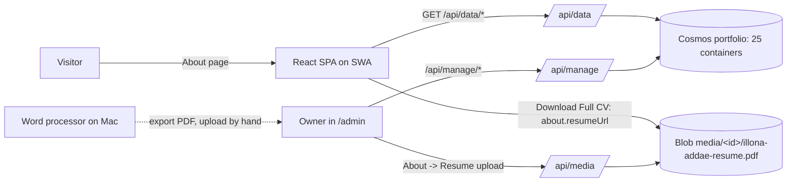
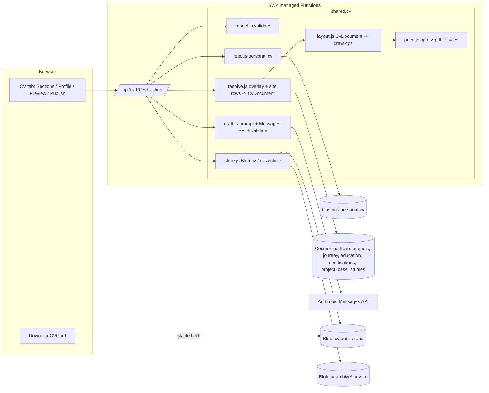

# Design: Living CV

Status: draft, for owner review
Owner: Illona Addae Date: 2026-11-02 Ticket: OC-0 (no Jira for this repo)

## 1. Problem

The CV PDF is edited by hand in a word processor, outside the site, so it drifts from the
portfolio. A lot of what it contains (awards, co-curricular work, GPA, expected graduation,
references, CV-only projects such as OMS) has nowhere to live in the admin today. The owner wants
to keep CV content in the dashboard, have Claude draft project bullets for approval, and press
"Publish CV" to get a server-built PDF that looks like the current one and is what "Download CV"
always serves.

Users: the owner (only admin) edits and publishes. Visitors and recruiters download the PDF,
often through an ATS that reads its text.

## 2. Goals and non-goals

Goals (owner decisions of 2026-10-24, treated as requirements)

1. Claude drafts a project's CV role line and 3 to 5 bullets in the CV's style. The draft is saved
   as a draft, and nothing reaches the CV until the owner approves or edits it.
2. Every project, experience, education and certification item gets a "Show on CV" switch and a CV order.
3. "Publish CV" builds the PDF on the server and stores it on Blob. The public download always
   serves the latest published PDF.
4. The output matches the current CV's layout (section 4.3).
5. CV-only content gets a home in the admin: awards, co-curricular, GPA, expected graduation,
   references, skills lines and CV-only entries.

Non-goals

- Several CV variants (per job, private "full" CV with referee contacts). The model leaves room
  for them, but they are not built.
- A Word or DOCX export.
- Changing how the public site shows projects, experience, education or certifications.
- Publishing automatically after an edit or a draft.

## 3. Constraints and assumptions

- Stack: React 19, TS and Vite in the browser. Azure Functions on Node 22, CommonJS
  (`api/*/index.js`), run as SWA managed functions. Cosmos for data, Blob account
  `oceaniccodermedia` for files. Prefer no new services.
- Cosmos `portfolio` database: 25 containers, the hard cap for shared throughput
  (`api/shared/cosmos.js:41-42`), and cut to 600 RU/s. Database `personal` has 400 RU/s shared
  and exists for owner-only data (`api/shared/finance/repo.js:1-10`).
- The repo is public. No real phone numbers, referee details or font files whose licence
  forbids redistribution may go into the repo or test fixtures.
- SWA proxies managed-function calls with about a 45 s timeout. A 2021 report puts the managed
  API package limit near 30 MB. Both figures are unconfirmed; see the risks table.
- Assumption (unconfirmed): `ANTHROPIC_API_KEY` is set in Azure. No code reads it today; see 4.4.
- Machine: designing only. Nothing was built or run except reading the reference PDF.

## 4. Context: how it works today

### 4.1 Data and reads

- Site content lives one container per kind in `portfolio`: `projects`, `journey` (work
  experience: `role`, `company`, `period`, `location`, `achievements[]`), `education` (`gpa`,
  `classHonours`, `endDate`, `isOngoing`, `location`, `isVisible`, `displayOrder`) and
  `certifications` (`title`, `issuer`, `date`, `platform`, ...). Types are in `src/types/index.ts`.
- Public reads go through `/api/data`. In `api/shared/publicData.js:25-42`, `projects`,
  `journey` and `certifications` have no row or field filter at all. Any field added to those
  rows is public, and so is any row.
- The read-only public `/dashboard` reads through `/api/data` too (`src/services/api/dataApi.ts:4-18`).
  So a CV draft field on a project row would show to every visitor there as well.
- Admin writes go through `/api/manage` (`api/manage/index.js`): generic PATCH/POST, with no
  server-side schema, guarded by `requireAdmin` (`api/shared/adminAuth.js`).
- Finance is the precedent for an owner-private feature. It is one action-dispatch function
  (`api/finance/index.js`), a repo in `personal` with partition `/scope`, and a self-contained
  tab registered in `TabContentExtra.tsx:147` behind `!isReadOnly`.

### 4.2 Files and the CV link

- Media lives in Blob container `media` as `<fileId>/<slug>`, with `Cache-Control: public,
max-age=31536000, immutable` (`api/shared/media.js:30`). The CV today is
  `media/6a5e7d9f002ec987f6e0/illona-addae-resume.pdf` and carries that immutable header (checked
  with curl), so the URL can never be overwritten in place.
- `listFiles` (`api/shared/media.js:248-266`) splits every blob name on `/` and lists it.
  Storage Cleanup (`src/components/AdminDashboard/tabs/StorageCleanupTab.tsx:36-48`) marks any
  file not referenced from Cosmos as an orphan. A CV stored under a new prefix in `media` would
  appear there as junk, and old versions would be offered for deletion.
- The only "Download CV" link on the site is `src/components/About/DownloadCVCard.tsx:13-17`:
  `about.resumeUrl`, with a hardcoded Google Drive URL as fallback. It renders in
  `src/components/About/EducationTab.tsx:55`. The admin sets `resumeUrl` by hand in About ->
  Resume (`tabs/About/ResumeSection.tsx`).

### 4.3 The reference PDF (measured from the file)

- 3 pages, US Letter (612 x 792 pt). It was exported by macOS Quartz from a word processor,
  with Verdana and Verdana-Bold subsets embedded. Bullet glyphs are Arial MT. A few certificate
  issuers are in Calibri 11, which is stray formatting, not design.
- Header: centred. Name in caps, Verdana regular 13.9 pt. Title in Verdana Bold 10.1 pt. Then
  three contact lines at 8.4 pt (location; phone / nationality; email). Then a link line,
  "LinkedIn Profile | GitHub Profile | Portfolio Website", underlined, with URI annotations to
  linkedin.com/in/illonaaddae, github.com/illonaaddae and oceaniccoder.dev.
- Body: Verdana 8.4 pt, line pitch about 11.3 pt. Left text edge 53 to 54 pt. Right-aligned
  dates end near 558 pt. Bottom margin about 72 pt.
- Section heading: Verdana Bold, caps, 8.4 pt (EDUCATION is 7.9 pt). A black horizontal rule
  runs from x 51.84 to 559.44, about 3 pt below the heading baseline. Rule weight is not
  measured yet; the spike in section 10 covers it.
- Entry pattern: a bold left line ("Org, – Location", location in regular weight) with a bold
  right-aligned date. Then a bold sub-line (role, or "Org | Type | Role") with an optional
  right-aligned date. Then bullets with a hanging indent of 18 pt. The bullet indent is
  inconsistent today (x 54 or 72).
- Sections in order: EDUCATION, ACHIEVEMENTS/AWARDS, WORK EXPERIENCE, PROJECTS AND RESEARCH,
  CERTIFICATIONS (bullet list, right date), CO-CURRICULAR ACTIVITIES, SKILLS ("Label: items"
  bullets), REFERENCES, then the footnote "\*WASSCE – West African Senior School Certificate
  Examination".
- References currently read "Available upon request". No referee details are published today.
- Quirks a faithful rebuild would either copy or clean (owner decision D3): ", –" between
  organisation and location; "Germany(Online)"; a stray "-en" after "180 ECTS"; "Cumulative GPA:
  N/A/5.00"; mixed date forms (Sept, Sep., full months); mixed bullet indents; Calibri runs.

### 4.4 AI today

- No code calls Anthropic. `grep -ri anthropic api src` finds nothing. The "AI quote drafter" is
  only a proposal (`docs/superpowers/specs/2026-10-10-client-quotes-design.md` section 15, never
  built), even though CLAUDE.md lists `ANTHROPIC_API_KEY` for it.
- The chatbot calls OpenAI with Node's `https` and no SDK (`api/chat/index.js:75-143`), with an
  in-memory per-IP limit. `api/shared/rateLimit.js:13` has a reusable fixed-window limiter.



## 5. Options and trade-offs

### Q1. Where CV data lives

The data has two kinds:

- Per-item CV state on site records: show, order, approved role line and bullets, a draft, and
  overrides such as a GPA line.
- CV-only content: profile header, awards, co-curricular, skills lines, references, footnotes,
  CV-only entries, and the publish history.

**A. Fields on existing records plus a private profile row.** Add a `cv` object to
`projects`, `journey`, `education` and `certifications` rows. Put CV-only projects in `projects`
with `showOnSite: false`. Put the profile JSON in a private `settings` row.

- Cost: every public collection needs `omit: ["cv"]`. `projects` needs a new row filter
  (`showOnSite`), and every place that lists projects needs checking: project pages, slugs,
  case studies, overview counts and the chat context.
- Risk: one missed `omit` or filter puts drafts, or a CV-only employer project, into public
  JSON and the public `/dashboard`.
- Generic `/api/manage` writes have no validation.

**B. A CV overlay store in `personal` (no new container in `portfolio`).** Add one container `cv`
in the existing `personal` database, partition `/scope` = `"cv"`, created on first use like
`finance`. It holds the profile doc, one overlay doc per CV entry (a link `{collection, id}` to
a site record, or none for CV-only entries), the drafts, the publish pointer, version records
and AI usage counters.

- Site records are untouched. `/api/data` and the public site do not change.
- Cost: a join at render and load time (about 4 small reads from `portfolio` plus 1 query on
  `cv`). Overlays can be orphaned when a site item is deleted.
- RU: shares the 400 RU/s with finance at no extra charge. CV traffic is a few requests a day.

**C. Smallest change: a single CV JSON document.** Keep one document with the whole CV, all
text copied in, edited as a form, with no links to site records.

- Cheapest to build.
- But it fails requirement 2 in spirit: there is no per-item switch on site items, and every
  edit to a project must be made twice. It also cannot ground the AI draft in the live project
  record.

| Criterion                 | A: fields on records                         | B: overlay in `personal`                      | C: one JSON doc  |
| ------------------------- | -------------------------------------------- | --------------------------------------------- | ---------------- |
| Meets reqs 1, 2, 5        | Yes                                          | Yes                                           | Partly (2 weak)  |
| Public exposure risk      | High (needs filters on 3 public collections) | None (no public reader of `personal`)         | None             |
| Change to live site paths | publicData, project lists, dashboard         | None                                          | None             |
| Container cap / RU        | No new container                             | No new `portfolio` container; shares 400 RU/s | No new container |
| Validation                | Generic manage, none                         | Own function with model checks                | Own function     |
| Orphans                   | None                                         | Possible, handled at load                     | n/a              |
| Reversibility             | Fields linger on public rows                 | Drop one container                            | Drop one doc     |

**Deciding factor:** exposure. `projects`, `journey` and `certifications` are fully public, and
so is the read-only dashboard. B keeps drafts and CV-only items off every public path by
construction, not by remembering a filter.

**Recommendation: B.**

- I would switch to A if the owner wants CV-only projects to appear on the site later, because
  they would then belong in `projects` anyway.
- I would also switch to A if `personal` must stay finance-only. In that case B's fallback is
  one private row in `portfolio.settings`, accepting generic-manage writes.

### Q2. PDF engine (Node 22, consumption, SWA managed)

| Criterion                                    | pdfkit 0.17                                                                                         | pdf-lib 1.17 + fontkit                                            | @react-pdf/renderer                                                                        | Headless Chromium (puppeteer-core + chromium pkg)                               |
| -------------------------------------------- | --------------------------------------------------------------------------------------------------- | ----------------------------------------------------------------- | ------------------------------------------------------------------------------------------ | ------------------------------------------------------------------------------- |
| Layout fidelity to a fixed 1-column template | High. Absolute positions, `widthOfString` for right-aligned dates, `heightOfString` for page breaks | High but manual: no line wrapping, which we would write ourselves | Good. Flexbox, but less control over exact baselines; hyphenates by default (must disable) | Highest for HTML/CSS, but print CSS needs tuning                                |
| Fonts                                        | Embeds and subsets TTF/OTF/WOFF                                                                     | Embeds via @pdf-lib/fontkit; subsetting has known glyph bugs      | Font.register, subsets                                                                     | System or bundled fonts                                                         |
| Text selectable, ATS                         | Yes, real text, link annots                                                                         | Yes                                                               | Yes                                                                                        | Yes                                                                             |
| Module format                                | CommonJS, fits `api/`                                                                               | CommonJS                                                          | ESM-first, needs `import()` from CJS, React on the server                                  | CJS, but a ~60 MB+ browser binary                                               |
| Bundle and cold start                        | One pure-JS library, no native code                                                                 | Small                                                             | Larger (React, yoga layout)                                                                | Very large; likely over the managed-API size cap; slow cold start; memory heavy |
| Maintenance                                  | Active (0.17.2, Aug 2025)                                                                           | Last release 2021                                                 | Active                                                                                     | Active                                                                          |
| Team fit                                     | Plain JS like the rest of `api/`                                                                    | Plain JS                                                          | React skills reused                                                                        | New ops surface                                                                 |

**Deciding factor:** exact control of positions in a tiny CommonJS package with no native or
browser binary. **Recommendation: pdfkit.**

- Split the code into two parts:
  - a pure `layout()` that turns the CV model into draw operations (testable, and tolerance-checked
    against the measured template);
  - a thin painter that feeds those operations to pdfkit.
- I would change my mind if the owner wants web-style theming of the CV (then react-pdf), or if
  SWA moves to a bring-your-own Functions app with room for Chromium.

**Fonts** (owner decision D2). Verdana is Microsoft's. The Mac's copy may not be redistributed,
and the repo is public, so it can never be committed. Options:

- (a) DejaVu Sans (Bitstream Vera licence, free to redistribute and embed). It is visually close
  to Verdana but I could not confirm it is metric-compatible, so line breaks will differ
  slightly. It goes in `api/shared/cv/fonts/` with its licence file.
- (b) A licensed Verdana (or Verdana Pro), bought from Monotype for server or app use, stored in
  a private Blob container and read once at cold start. It is never in the repo.
- Recommendation: build on (a) behind a font loader that reads (b) when `CV_FONT_BLOB_PREFIX` is
  set, so the font can switch with no code change.
- The bullet glyph comes from the same font (DejaVu has U+2022), so Arial is not needed.
- Text stays real text, so ATS parsing works. Set the title, author and subject metadata.

### Q3. AI draft flow

**A. One admin action on a new `/api/cv` function (recommended).**

1. The browser sends only `{action:"draft", entryId}`.
2. The server loads the linked project (and its `project_case_studies` row) from Cosmos itself,
   or the CV-only entry's `sourceNotes`.
3. It calls the Messages API with structured JSON output and validates the result.
4. It stores the result as `entry.draft`.

- Grounded in the server's copy of the data, so the client cannot steer the prompt beyond what
  the owner already saved.

**B. The browser sends free text to a generic "complete" endpoint.**

- Simpler, but the endpoint becomes an open, owner-authenticated LLM proxy, and the result is not
  tied to a record. Rejected.

**C. Smallest change: no AI.** The owner writes the bullets by hand in the entry editor.

- This is what the system falls back to when the key or cap is missing, so it ships first anyway.

Details of A in section 7.4.

### Q4. Publish, versions and the stable URL

**A. Pointer function.** `/api/cv-download` 302-redirects to the current immutable version blob.

- One function call per download, so a cold start for recruiters.
- Downloads fail when Functions are down.

**B. Fixed "latest" blob plus a private archive (recommended).**

- Every publish writes:
  - `cv-archive/v0007-20261102.pdf`, private, immutable;
  - the public `cv/illona-addae-cv.pdf`, overwritten, short cache.
- Downloads are served by Blob directly, with no function in the path.
- Rollback writes an archived version back over the public blob and moves the pointer.

**C. Smallest change.** Publish only overwrites one blob, with no history and no rollback.
Rollback is a stated requirement area, so no.

Why two containers rather than a prefix in `media`:

- `media` blobs carry a 1-year immutable cache and appear in Storage Cleanup (section 4.2).
- Old CV versions should not be public. If the owner drops the phone number later, archived
  versions stay private.
- Creating two containers is a shared-infrastructure change for the owner to approve (D9).

**Recommendation: B.**

- Stable public URL: `https://oceaniccodermedia.blob.core.windows.net/cv/illona-addae-cv.pdf`.
- Optional vanity route `https://oceaniccoder.dev/cv` as an SWA `routes` redirect
  (`staticwebapp.config.json`), with no function.
- Headers on the latest blob: `Cache-Control: public, max-age=300`,
  `Content-Type: application/pdf`, `Content-Disposition: inline; filename="Illona-Addae-CV.pdf"`,
  and metadata `cvversion=7`.
- The old media URL stays as it is. It may be linked from past applications, and its immutable
  header means it cannot be refreshed reliably anyway.

### Q5. References on a public PDF (owner decision D1)

| Option                                                        | Privacy                                                                                                                                     | Effort |
| ------------------------------------------------------------- | ------------------------------------------------------------------------------------------------------------------------------------------- | ------ |
| Keep "Available upon request" (today's text)                  | No third-party data published or stored                                                                                                     | None   |
| List referee name, role and org only, with contact on request | Low; needs each referee's agreement to be named                                                                                             | Small  |
| List full contacts (email, phone)                             | Referees' personal data on a public, indexable, scrapeable file; needs explicit consent from each, and their spam risk is the owner's doing | Small  |

Recommendation: keep "Available upon request".

- The model still stores `references.mode`. If the owner chooses "listed", referee rows are
  stored only in the private `cv` container and rendered only in that mode.
- Never put referee data in the repo or fixtures.

### Q6. Admin UI

**A. One new "CV" tab, owner-only like Finance (recommended).** Four sub-views:

- Sections. One ordered list per CV section, mixing linked site items (badge "Site") and CV-only
  ones (badge "CV only"). Each row has the Show switch, up and down order buttons, Edit, and,
  for projects, "Draft with AI". A row with a pending draft shows "Draft waiting".
- Profile. Header and contact, awards, co-curricular, skills lines, references mode, footnotes.
- Preview. "Build preview" renders the PDF server-side without storing it, shows it in an
  `<iframe>` from a blob URL, and lists warnings (shown entries with no approved text, orphaned
  links, overflowing lines, page count changed from the last publish).
- Publish. A "Publish CV" button with an optional note. A confirm dialog shows the warnings and
  the page count. Below it, the version history with "Make current" (rollback) and "Download".

**B. A switch inside each of the 4 existing forms, plus a CV tab for the rest.**

- Closer to the literal wording of requirement 2, but it touches 4 form folders and their
  submit handlers, and it spreads CV state across two places.
- It can be added later as a read-only badge ("On CV") in each list.

Recommendation: A. Whether the switch must also appear in each form is D4.

- Hidden when `isReadOnly`.
- Register in both `TabType` unions (`src/components/AdminDashboard/types.ts` and
  `SidebarParts/types.ts`), `SidebarParts/tabs.ts` and `TabContentExtra.tsx`.

## 6. Recommendation summary

- Data: a CV overlay in `personal.cv`.
- Rendering: pdfkit with a pure layout module and a swappable font.
- AI: `/api/cv` action `draft` grounded in server data, saved as a draft, approve as a separate action.
- Publishing: a public "latest" blob plus a private archive, with rollback by copy.
- UI: one owner-only CV tab with a server-rendered preview.
- References: default to "Available upon request".

What would change it:

- The owner wants CV-only items on the site (data option A).
- A CV theme engine is wanted (react-pdf).
- Verdana cannot be licensed and DejaVu's line breaks are unacceptable. The fallback is to
  re-tune sizes to fit, not to change engine.

## 7. Design

### 7.1 Components



Responsibilities

- `api/cv/index.js`: `requireAdmin`, then `readJson`, dispatch on `action`, and `handleError`
  (the same shape as `api/finance/index.js`).
- `shared/cv/model.js`: validates profile and entry input (lengths, counts, URL schemes `https:`
  and `mailto:` only, no control characters). Pure.
- `shared/cv/repo.js`: the `personal.cv` container, created on first use. Single-partition reads.
  Writes use `IfMatch` etags. Reorders use a transactional batch.
- `shared/cv/resolve.js`: joins the overlays with the site rows into a `CvDocument`, fills
  defaults (e.g. experience bullets fall back to `journey.achievements`), skips hidden, orphaned
  and unapproved entries, and returns `warnings[]`. Pure, given its inputs.
- `shared/cv/layout.js`: turns a `CvDocument` plus font metrics into
  `{ pages: DrawOp[][], warnings }`. Pure. All template constants (section 4.3) live here.
- `shared/cv/paint.js`: draws `DrawOp`s with pdfkit and returns a Buffer. Sets the metadata.
- `shared/cv/draft.js`: builds the prompt, calls the Messages API with `fetch` and an
  `AbortController`, validates the result, and returns a draft. No SDK: the chatbot already calls
  an LLM over plain HTTPS, and one POST does not justify a dependency.
- `shared/cv/store.js`: writes and reads the two Blob containers through `getContainer`-style
  helpers from `shared/media.js`, extended to take a container name. It does not use `listFiles`.

### 7.2 Data model (`personal` db, container `cv`, partition `/scope` = "cv")

```ts
// id "profile"
interface CvProfile {
  id: "profile";
  scope: "cv";
  type: "profile";
  header: {
    name: string;
    title: string;
    lines: string[]; // location; phone / nationality; email
    links: { label: string; url: string }[];
  }; // LinkedIn / GitHub / Portfolio
  awards: { id: string; title: string; issuer?: string; year: string; order: number }[];
  coCurricular: {
    id: string;
    org: string;
    role: string;
    period: string;
    bullets: string[];
    order: number;
  }[];
  skills: { id: string; label: string; items: string; order: number }[]; // "Languages: ..."
  references: {
    mode: "on-request" | "listed";
    text: string; // default "Available upon request"
    referees: {
      id: string;
      name: string;
      role: string;
      org: string;
      email?: string;
      phone?: string;
    }[];
  };
  footnotes: string[]; // "*WASSCE – ..."
  createdAt: string;
  updatedAt: string;
}

// id "entry.<section>.<sourceId>" for a linked item, "entry.<section>.cv-<newId>" for CV-only
interface CvEntry {
  id: string;
  scope: "cv";
  type: "entry";
  section: "education" | "experience" | "projects" | "certifications";
  source: {
    collection: "education" | "journey" | "projects" | "certifications";
    id: string;
  } | null;
  show: boolean;
  order: number; // ascending within the section, gaps allowed (10, 20, ...)
  fields: {
    // CV-only content, or overrides of the linked record
    title?: string;
    org?: string;
    location?: string;
    period?: string;
    periodRight?: string;
    subtitle?: string; // e.g. degree line, or "Team Member (Final Year Project)"
    gpa?: string;
    gpaScale?: string; // renders "Cumulative GPA: 4.30/5.00"
    expectedGraduation?: string; // renders "Expected Date of Graduation: September 2027"
    label?: string; // certifications: "(In-progress)"
  };
  sourceNotes?: string; // CV-only projects: what the AI drafts from (max 8,000 chars)
  approved?: { roleLine: string; bullets: string[]; approvedAt: string };
  draft?: {
    roleLine: string;
    bullets: string[];
    warnings: string[];
    model: string;
    promptVersion: number;
    sourceHash: string;
    createdAt: string;
    usage: { inputTokens: number; outputTokens: number };
  };
  createdAt: string;
  updatedAt: string;
}

// id "publish": the pointer, the one document every publish and rollback swaps with IfMatch
interface CvPublishState {
  id: "publish";
  scope: "cv";
  type: "publish";
  current: number | null;
  next: number;
  latestSyncedVersion: number | null;
}

// id "version.0007"
interface CvVersion {
  id: string;
  scope: "cv";
  type: "version";
  version: number;
  archiveBlob: string;
  sha256: string;
  bytes: number;
  pages: number;
  publishedAt: string;
  publishedBy: string;
  note?: string;
  snapshot: CvDocument; // the resolved content, for audit and diff (< 100 KB)
}

// id "ai-usage.2026-11-02"
interface CvAiUsage {
  id: string;
  scope: "cv";
  type: "ai-usage";
  day: string;
  drafts: number;
  inputTokens: number;
  outputTokens: number;
}
```

Rules

- Bullets: 1 to 6 per entry, each up to 300 chars. The role line is up to 160 chars. AI drafts
  must have 3 to 5 bullets.
- A linked entry's text resolves in this order: approved, then overrides, then the site record.
  For projects, `approved` is required; otherwise the entry is skipped with a warning. For
  experience, the bullets fall back to `journey.achievements`.
- A linked item with no overlay is not shown on the CV (default off), so a new site project
  never appears on the CV unannounced. A migration (section 8) creates overlays for today's items.
- Orphans (overlay links an id that no longer exists): reported in `load` and in preview
  warnings, skipped at render, and deletable from the UI.

### 7.3 Contract: `POST /api/cv` (admin only, JSON, `Cache-Control: no-store`)

| action          | input                                        | output                                                                                                                                                                      | errors                                                                                                                                                                                        |
| --------------- | -------------------------------------------- | --------------------------------------------------------------------------------------------------------------------------------------------------------------------------- | --------------------------------------------------------------------------------------------------------------------------------------------------------------------------------------------- |
| `load`          | none                                         | `{ profile, entries, sources: { projects, journey, education, certifications }, publish: { current, versions: CvVersionSummary[] }, ai: { enabled, usedToday, dailyCap } }` | 503 store unavailable                                                                                                                                                                         |
| `saveProfile`   | `{ profile, etag }`                          | `{ profile, etag }`                                                                                                                                                         | 400 invalid, 409 stale                                                                                                                                                                        |
| `saveEntry`     | `{ entry, etag? }` (create when no etag)     | `{ entry, etag }`                                                                                                                                                           | 400, 409                                                                                                                                                                                      |
| `deleteEntry`   | `{ id, etag }`                               | `{ deleted: true }`                                                                                                                                                         | 404, 409                                                                                                                                                                                      |
| `reorder`       | `{ section, ids: string[] }`                 | `{ entries }`                                                                                                                                                               | 400 (ids not exactly the section's entries)                                                                                                                                                   |
| `draft`         | `{ entryId }`                                | `{ entry }` with `draft` set                                                                                                                                                | 400 not a project, or no source text; 404; 429 daily cap or per-minute limit; 503 AI not configured or upstream down; 502 model output failed validation twice                                |
| `approve`       | `{ entryId, roleLine, bullets, etag }`       | `{ entry }` (`approved` set, `draft` cleared)                                                                                                                               | 400, 409                                                                                                                                                                                      |
| `discardDraft`  | `{ entryId, etag }`                          | `{ entry }`                                                                                                                                                                 | 409                                                                                                                                                                                           |
| `preview`       | none                                         | `{ pdfBase64, pages, warnings }`                                                                                                                                            | 422 nothing to render; 500 render failed                                                                                                                                                      |
| `publish`       | `{ expectedCurrent: number \| null, note? }` | `{ version, latestUrl, pages, warnings }`                                                                                                                                   | 409 someone published meanwhile; 422 blocking warnings; 502 Blob write failed; 207-style `{ version, latestSynced: false }` when the archive and pointer succeeded but the latest copy failed |
| `rollback`      | `{ version, expectedCurrent }`               | `{ current }`                                                                                                                                                               | 404, 409                                                                                                                                                                                      |
| `syncLatest`    | none                                         | `{ latestSyncedVersion }`                                                                                                                                                   | 502                                                                                                                                                                                           |
| `deleteVersion` | `{ version }`                                | `{ deleted }`                                                                                                                                                               | 409 if current                                                                                                                                                                                |

- The preview returns base64 JSON, so it reuses `send()` from `api/shared/http.js`.
- `readJson`'s 64 KB body cap is fine for every input. Profile and entries are small.

### 7.4 AI draft

```mermaid
sequenceDiagram
  participant A as Owner (CV tab)
  participant F as /api/cv
  participant P as personal.cv
  participant C as portfolio (projects, case studies)
  participant M as Messages API
  A->>F: {action:"draft", entryId}
  F->>F: requireAdmin, per-instance limit (3/min)
  F->>P: read entry + ai-usage.today
  alt AI disabled, or drafts today >= cap
    F-->>A: 503 or 429 with reason (owner writes by hand)
  end
  F->>C: read project + case study by source.id (or use entry.sourceNotes)
  F->>F: build prompt: style rules + 2 approved bullets sets as examples + record fields
  F->>M: POST /v1/messages (structured JSON output, max_tokens 800, 25 s abort)
  alt timeout / 429 / 5xx
    F-->>A: 503 "Claude did not answer, try again" (no retry inside the request)
  end
  F->>F: validate schema, 3-5 bullets, lengths, strip em dashes; on fail retry once
  F->>P: patch entry.draft (IfMatch) + increment ai-usage (same partition batch)
  F-->>A: entry with draft
  A->>A: edit in place
  A->>F: {action:"approve", roleLine, bullets, etag}
  F->>P: entry.approved = edited text, draft removed
```

Prompt grounding

- System prompt with the CV style rules:
  - past-tense action verbs (present tense for a current role), one claim per bullet;
  - no invented numbers, metrics, team sizes or clients, so only facts in the record;
  - at most 2 printed lines (about 190 chars) per bullet;
  - no em or en dashes (house style, `api/chat/index.js` prompt);
  - role line pattern "Context | Type | Role" as in the reference;
  - an optional last bullet "Tech stack: ..." when technologies are known.
- Two approved entries from the same CV as style examples.
- The record: title, description, longDescription, role, teamSize, timeline, technologies,
  keyFeatures, challenge, solution, results, the case-study text, or `sourceNotes`.

Output schema

- `{ roleLine: string, bullets: string[3..5], warnings: string[] }`.
- `warnings` is the model's list of claims it could not ground and fields it found missing. It
  is shown only in the admin.

Cost and safety

- Admin only (`requireAdmin`).
- Per-instance limiter (`createRateLimiter({limit: 3})`) to stop double-clicks.
- A durable daily cap in `ai-usage.<day>` (default 30 drafts/day, env `CV_DRAFT_DAILY_CAP`,
  owner decision D6). Inputs are truncated to 12,000 chars and `max_tokens` is 800, so one
  draft's cost is bounded.
- The model comes from env `CV_DRAFT_MODEL`, with a default picked at build time from the
  current models page.
- Structured output uses the current request shape (`output_config.format` with a JSON schema,
  or a forced tool call). Check it against the live docs when PR 4 is built, and validate on the
  server regardless.

Never auto-publish

- `draft` writes only `entry.draft`. The resolver reads only `approved`.
- `publish` is a separate, confirmed action.

Failure handling

- If `ANTHROPIC_API_KEY` is missing, the AI is "not configured": a 503 with a clear message,
  logged once per instance. The UI hides the AI button when `load` says `ai.enabled=false`.

### 7.5 Publish and rollback

```mermaid
sequenceDiagram
  participant A as Owner
  participant F as /api/cv
  participant P as personal.cv
  participant B as Blob (cv-archive, cv)
  A->>F: {action:"publish", expectedCurrent: 6}
  F->>P: read publish state, profile, entries; read site rows
  F->>F: resolve -> layout -> paint (in memory)
  alt blocking warnings (no entries, overflow off page)
    F-->>A: 422 with warnings
  end
  F->>B: put cv-archive/v0007-20261102.pdf (If-None-Match *)
  F->>P: batch: create version.0007 + replace publish {current:7,next:8} IfMatch
  alt 412 (another publish won)
    F-->>A: 409; archive blob v0007 left as an unreferenced orphan, listed for cleanup
  end
  F->>B: put cv/illona-addae-cv.pdf (cache 300 s, metadata cvversion=7)
  alt Blob write fails
    F-->>A: {version:7, latestSynced:false} -> UI shows "Retry sync"
  end
  F->>P: publish.latestSyncedVersion = 7
  F-->>A: {version:7, latestUrl}
```

- Ordering: archive, then pointer, then latest. A failure at any step leaves a state that `load`
  can detect (`current != latestSyncedVersion`) and `syncLatest` can repair idempotently. The
  public file is never newer than the pointer.
- Rollback: read `cv-archive/vNNNN`, write it over `cv/illona-addae-cv.pdf`, and set
  `current = NNNN` with IfMatch. History is never rewritten.
- Time budget: render plus two small uploads is well under the 45 s proxy limit. Rendering is
  synchronous CPU for a 3-page document. Measure it in the spike.
- Caching: the public blob has `max-age=300`, so a publish shows within 5 minutes. The admin
  "Open" link adds `?v=7` to bypass caches.

### 7.6 Site link

- `DownloadCVCard.tsx` replaces the Google Drive fallback with the stable URL from a constant in
  `src/utils/imageUrls.ts`, beside the existing media base.
- A one-time data step sets `about.resumeUrl` to the stable URL.
- About -> Resume shows "Managed by the CV tab", with the URL and a link there, and keeps the
  manual upload as an override. Whether to remove the override is the owner's call (D10).

### 7.7 Auth, security, privacy

- Every action goes through `requireAdmin`, which also enforces same-origin and JSON. Nothing in
  `personal` is reachable from `/api/data`.
- URLs in header links are limited to `https:` and `mailto:`, so a pasted `javascript:` link
  cannot end up in a PDF annotation.
- The public PDF is public and indexable. It contains the phone number and email today (D8).
- Referee rows are stored only if the owner picks "listed" (D1).
- Fixtures and tests use made-up data. The real profile is entered through the UI, never seeded
  from the repo.

### 7.8 Observability

- `context.log` lines at each step:
  - `cv.publish` with version, bytes, pages and ms;
  - `cv.draft` with model, tokens, ms and outcome;
  - `cv.sync` failures.
- No PDF text and no prompt text in the logs.
- The CV tab shows the current version, the latest-synced status, today's AI usage against the
  cap, and the last publish time.

### 7.9 Test strategy

- Unit tests (Vitest, the existing pattern in `api/**/*.test.js` with `fakeCosmos.js`):
  - `model.js` validation;
  - `resolve.js` defaults, orphans and hidden or unapproved skips;
  - `draft.js` validation of good, short, long and dashed output, with the fetch stubbed;
  - the `api/cv` action dispatch with fake repo and store, covering 401/403, 409 stale, the cap
    and publish ordering failures.
- Layout golden test: a fixture `CvDocument` built like the reference, with fake contact data.
  `layout()` must place the name, headings, rules, right-aligned dates and bullet indents within
  1 pt of the measured template constants, and must not leave a heading or entry header alone at
  the bottom of a page.
- Paint smoke test: pdfkit produces a Buffer that starts with `%PDF-`, has the expected page
  count, and contains the link annotations.
- Manual acceptance (owner): put the published PDF next to the reference PDF, and check that
  text can be selected and copied in Preview and Acrobat. Run one free ATS parser check.
- UI: Testing Library tests for the CV tab (switch, reorder, draft badge, approve, publish
  confirm), plus a browser check per CLAUDE.md.

## 8. Rollout (PRs in build order, each well under 24 files)

| PR                             | Scope                                                                                                                                                                                                                                                                                                                                                                 | Files (approx.) |
| ------------------------------ | --------------------------------------------------------------------------------------------------------------------------------------------------------------------------------------------------------------------------------------------------------------------------------------------------------------------------------------------------------------------- | --------------- |
| 0 Spike (no merge)             | Measure the rule weight and spacing exactly. Render a fixture with pdfkit and DejaVu Sans, compare line breaks against Verdana (local Mac copy, not committed), time cold render, check the `api/` package size with pdfkit added. Writes the numbers into this doc.                                                                                                  | n/a             |
| 1 CV store and API skeleton    | `api/cv/{index.js,function.json,actions.js,cv.test.js}`, `api/shared/cv/{model.js,model.test.js,repo.js,repo.test.js}`. Actions: load, saveProfile, saveEntry, deleteEntry, reorder. No rendering, no AI.                                                                                                                                                             | 8               |
| 2 CV tab: Sections and Profile | `src/services/api/cv.ts` (+test), `tabs/Cv/{CvTab,SectionsView,EntryEditor,ProfileView,ui}.tsx` (+tests), both `TabType` files, `SidebarParts/tabs.ts`, `TabContentExtra.tsx`. Ends with the owner able to enter all CV content.                                                                                                                                      | about 14        |
| 3 Renderer and preview         | add `pdfkit` (pinned) to `api/package.json` + lock, `api/shared/cv/{resolve,layout,paint}.js` + tests, `fonts/` (DejaVu Sans regular/bold + LICENSE), `preview` action, `tabs/Cv/PreviewView.tsx`.                                                                                                                                                                    | about 14        |
| 4 AI drafts                    | `api/shared/cv/draft.js` + test, `draft`/`approve`/`discardDraft` actions, usage counter, `tabs/Cv/DraftPanel.tsx` + test, CLAUDE.md env rows (`ANTHROPIC_API_KEY` now real, `CV_DRAFT_MODEL`, `CV_DRAFT_DAILY_CAP`).                                                                                                                                                 | about 8         |
| 5 Publish, history, rollback   | `api/shared/cv/store.js` + test, small change in `shared/media.js` to take a container name, publish/rollback/syncLatest/deleteVersion actions, `tabs/Cv/PublishView.tsx` + test, CLAUDE.md (`CV_BLOB_CONTAINER`, `CV_ARCHIVE_CONTAINER`, `CV_FONT_BLOB_PREFIX`). Infra (owner approves): create Blob containers `cv` (public read: blob) and `cv-archive` (private). | about 9         |
| 6 Switch the site link         | `DownloadCVCard.tsx`, `utils/imageUrls.ts`, `ResumeSection.tsx`, optional `staticwebapp.config.json` `/cv` redirect, test. Data step: set `about.resumeUrl`, first publish.                                                                                                                                                                                           | about 5         |

Migration of content

- After PR 2 the owner enters today's CV in the tab: create overlays for the existing site items
  and CV-only entries for OMS, WasteFlow and others, then fill awards, co-curricular and skills.
- A local, untracked import script is possible, but it would put the phone number in a file;
  manual entry takes roughly 30 to 60 minutes and avoids that.
- The first publish happens only after a side-by-side check with the reference.

Rollback of the feature

- PR 6 is the only visitor-facing change. Reverting it, or setting `about.resumeUrl` back to the
  old media URL, restores today's behaviour instantly.
- The `cv` container and blobs are additive.

## 9. Risks and open questions

| Risk or unknown                                                         | Owner                 | How to retire                                                                                         | Blocks |
| ----------------------------------------------------------------------- | --------------------- | ----------------------------------------------------------------------------------------------------- | ------ |
| DejaVu Sans line breaks differ from Verdana, so "matches exactly" fails | Architect, then owner | Spike PR 0: render the reference content in both, diff the line breaks; owner decides D2              | PR 3   |
| Managed API package size or proxy timeout (unconfirmed 30 MB / 45 s)    | Engineer              | Spike: measure `api/` zipped size with pdfkit and fonts; time a cold publish in a preview environment | PR 3   |
| `ANTHROPIC_API_KEY` not actually set (no code has used it)              | Owner                 | Confirm in Azure, Configuration; `load` reports `ai.enabled`                                          | PR 4   |
| AI invents claims                                                       | Engineer              | Grounding plus rules, a `warnings` list, approval gate, and the resolver reads only approved text     | none   |
| Publish partially fails (pointer moves, latest not written)             | Engineer              | Ordered writes, `latestSyncedVersion`, idempotent `syncLatest`; tests for each failure step           | none   |
| Two tabs publish at once                                                | Engineer              | IfMatch on the `publish` doc; the loser gets 409                                                      | none   |
| `personal` 400 RU/s shared with finance                                 | Engineer              | CV is a few requests a day; single-partition reads; check RU charge in the spike                      | none   |
| Orphaned overlays after a site item is deleted                          | Engineer              | Shown in `load` and preview warnings, skipped at render                                               | none   |
| Old media CV URL keeps circulating                                      | Owner                 | Decide whether to leave it (default) or replace its content (cache-immutable, unreliable)             | none   |
| Two `TabType` unions drift                                              | Engineer              | Update both in PR 2; test that the sidebar renders the CV tab                                         | PR 2   |

## 10. Owner decisions still open

1. **D1 References.** Keep "Available upon request" (recommended), list names only, or list full
   contacts with each referee's consent.
2. **D2 Font.** Free DejaVu Sans (close, not identical), or buy a server licence for Verdana and
   keep the file in a private Blob (exact look, ongoing licence).
3. **D3 Quirks.** Reproduce the reference's punctuation and indent inconsistencies exactly, or
   normalise them: one bullet indent, one date format, "Org – Location", no "-en" or "N/A/5.00".
   The recommendation is to normalise and keep the layout.
4. **D4 Switch placement.** CV tab only (recommended), or also a "Show on CV" switch inside each
   of the 4 existing forms.
5. **D5 Default for new items.** Off until added (recommended), or on.
6. **D6 AI limits.** Daily draft cap (default 30) and model tier (cost versus quality).
7. **D7 Stable URL.** File name (`illona-addae-cv.pdf`?), and whether to add `oceaniccoder.dev/cv`.
8. **D8 Personal data on the public PDF.** Keep the phone number and nationality line?
9. **D9 Infrastructure.** Approve creating the Cosmos container `personal.cv` and the Blob
   containers `cv` (public) and `cv-archive` (private).
10. **D10 Manual upload.** Keep the About -> Resume manual upload as an override, or remove it
    once the CV tab is live.
11. **D11 Blocking rules.** Should publish refuse when the PDF grows past 3 pages, or only warn?

## 11. ADR

# ADR-001: Living CV built from an overlay store and rendered with pdfkit

- Status: proposed
- Date: 2026-11-02
- Deciders: Illona Addae
- Ticket: OC-0

### Context

The CV is maintained by hand in a word processor and drifts from the site. CV-only content has no
home in the admin. `portfolio` is at the 25-container cap and 600 RU/s. `projects`, `journey` and
`certifications` are served with no field filter to the public site and the read-only dashboard.
Functions are CommonJS on SWA managed Functions, with a 45 s proxy timeout (unconfirmed) and a
package size limit. The repo is public. Verdana cannot be redistributed.

### Decision

We will keep all CV state in a new container `cv` in the existing private `personal` database:
overlays linked to site records, CV-only entries, the profile, drafts, publish history and AI
usage. It will be edited through one admin-only `/api/cv` action function. The PDF will be
rendered server-side with pdfkit from a pure layout module that encodes the measured template,
using DejaVu Sans unless a licensed Verdana is provided from a private Blob. Claude drafts go only
to `entry.draft`. Rendering reads only approved text. Publishing writes an immutable private
archive copy, moves a pointer with an etag check, and then overwrites one public, short-cache blob
that the site links to.

### Options considered

1. CV fields on site records. Simple joins, but drafts and CV-only items end up on public read
   paths unless several filters are added and kept correct.
2. Overlay store in `personal` (chosen). No public exposure and no new `portfolio` container.
   Costs a join and handling of orphans.
3. One CV JSON document (smallest change). Fails the per-item switch and AI grounding, and every
   edit happens twice.

Engines considered: pdfkit (chosen), pdf-lib (no text wrapping, last release 2021),
@react-pdf/renderer (ESM, heavier, less baseline control), headless Chromium (size, cold start,
memory).

### Consequences

Positive

- No change to public read paths. Drafts never leave the admin.
- Pure, testable layout. No native or browser binaries.
- Downloads are served by Blob with no function in the path. Rollback is a copy.

Negative and trade-offs accepted

- Joins and orphan handling across two databases.
- DejaVu Sans differs slightly from Verdana unless the owner licenses Verdana.
- A second LLM integration built on raw HTTPS, kept in line with the chatbot.

Follow-ups and what to watch

- Spike numbers (package size, render time, line-break diff).
- RU charge on `personal`.
- AI cost against the daily cap.

### Revisit when

- CV-only items should appear on the site.
- Several CV variants are needed.
- Functions move to a bring-your-own app where Chromium is viable.
- `personal` needs more throughput.

## Unrelated observations (reported, not part of this change)

- `api/manage/index.js:17-18` says the route is limited to the admin role in
  `staticwebapp.config.json`, but `staticwebapp.config.json:19-22` allows `anonymous` on
  `/api/*`. `requireAdmin` is the real guard, and it holds. The comment is wrong.
- CLAUDE.md lists `ANTHROPIC_API_KEY` as used by the AI quote drafter (PR 1b), which was never
  built.
- `api/shared/cosmos.js:7-9` and `:18` still describe 1,000 RU/s shared, while the database was
  cut to 600 RU/s.

Sources: [SWA managed function timeout (Microsoft Q&A)](https://learn.microsoft.com/en-us/answers/questions/544714/swa-azure-function-backend-returns-500-after-45-se),
[SWA managed API size (GitHub issue)](https://github.com/Azure/static-web-apps/issues/214),
[SWA plans](https://learn.microsoft.com/azure/static-web-apps/plans),
[pdfkit on npm](https://npmjs.com/package/pdfkit), [pdfkit repo](https://github.com/foliojs/pdfkit),
[Verdana alternatives](https://fontalternatives.com/alternatives/verdana/for/documents/),
[Claude structured outputs guide](https://r43lab-site.pages.dev/blog/claude-structured-outputs).

## Owner decisions, 2026-11-02

- D1 References: "Available upon request". No referee details stored.
- D2 Font: DejaVu Sans (spike checks line breaks against the reference).
- D3 Quirks: clean them up. Same layout and sections, one date format, one bullet indent.
- D8 Phone and nationality: keep. Owner: the generated CV must look like the current CV; it simply grows as new things are added.
- D5 / publish (changes the design): new site items go ON the CV by default. Projects: Claude drafts the CV lines, owner taps Approve once, then the PDF rebuilds and the public download updates automatically. Jobs and certificates with no AI text update straight away. No manual Publish step needed for normal updates (keep history and rollback).
- Open, defaults taken: D4 show-on-CV switch in the CV tab and in each item's form; D6 daily AI cap 30, model via env; D7 stable URL cv/illona-addae-cv.pdf plus /cv redirect; D9 personal.cv container + Blob cv (public) / cv-archive (private): owner approves before creation; D10 keep manual resume upload as override; D11 warn (not block) past 3 pages.
- Owner to confirm ANTHROPIC_API_KEY is set in Azure (no code uses it yet).
